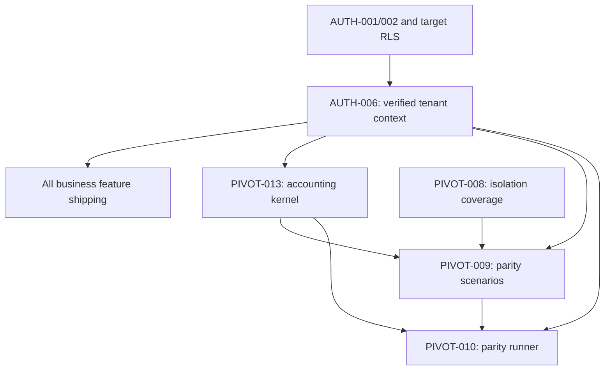

# State

Updated: 15 November 2026 (Asia/Karachi)  
Generated from the repository, not from memory.  
Integration branch: `testing-1`  
Head: `9799ced94db422e1f3328561dd70a3bf0ef6b377` — Merge documentation from codex/postgresql-engineering-20261115 into testing-1  
Working tree at generation: clean.

## Open pull requests

| PR | Head branch | Title | State |
| --- | --- | --- | --- |
| #1 | `opencode/pivot-002` | PIVOT-002d: restore database-independent check and supply Verify SAVEN PR evidence | open, unmerged |

## Contracts

Contract files live in `docs/contractor/contracts/`. Status is derived from git
history, delivery files and review files on `testing-1`; chat claims are not
evidence.

| Contract | Status | Evidence |
| --- | --- | --- |
| AUTH-001-schema | blocked | contract only; prerequisite PIVOT-002 unmerged |
| AUTH-002-sessions | blocked | contract only; prerequisite AUTH-001 |
| AUTH-003-passwords-and-limits | blocked | contract only; prerequisite AUTH-002 |
| AUTH-004-mfa | blocked | contract only; prerequisite AUTH-003 |
| AUTH-005-verification-and-reset | blocked | contract only; prerequisite AUTH-004 |
| AUTH-006-tenant-context | blocked | contract only; prerequisites AUTH-001/002/005 and PIVOT-004 |
| AUTH-007-operator-access | blocked | contract only; prerequisite AUTH-006 |
| AUTH-008-oidc-readiness | blocked | contract only; prerequisite AUTH-001 |
| AUTH-009-auth-audit | blocked | contract only; prerequisites AUTH-002..007 |
| AUTH-010-security-docs | blocked | contract only; prerequisites AUTH-001..009 |
| PIVOT-002-operator-schema | in-progress | open PR #1; review `docs/contractor/reviews/PIVOT-002-operator-schema.md`; not merged |
| PIVOT-002b-operator-schema-fixes | in-progress | contract commit `a202d66`; implementation on open PR #1; not merged |
| PIVOT-003-tenant-schema | blocked | contract only; prerequisite PIVOT-002 |
| PIVOT-004-tenant-rls | blocked | contract only; prerequisites PIVOT-003 and AUTH-001 |
| PIVOT-005-posted-immutability | blocked | contract only; prerequisite PIVOT-004 |
| PIVOT-006-audit-triggers | blocked | contract only; prerequisites PIVOT-005 and AUTH-006 |
| PIVOT-007-operator-functions | blocked | contract only; prerequisites PIVOT-006 and AUTH-007 |
| PIVOT-008-rls-coverage | blocked | contract only; prerequisites PIVOT-007, AUTH-006/007 |
| PIVOT-009-parity-scenarios | blocked | contract only; prerequisites PIVOT-013, PIVOT-008, AUTH-006 |
| PIVOT-010-parity-runner | blocked | contract only; prerequisites PIVOT-009, PIVOT-013, AUTH-006 |
| PIVOT-011-backup-runbook | blocked | contract only; runbook drafting is independent but not assigned |
| PIVOT-012-verification-evidence | blocked | contract only; all AUTH/PIVOT deliverables |
| PIVOT-013-accounting-kernel | blocked | contract only; prerequisites PIVOT-003/004/005/006, AUTH-006 |

No delivery files exist on `testing-1`. No contract is merged. The only review
file on `testing-1` is the PIVOT-002 review.

## Dependency graph

Dependencies below govern future human-assigned implementation and acceptance. No contractor task is executed here. Schema/interface drafting may overlap where files are disjoint; no business feature is shipped/integrated, and no real parity acceptance occurs, before AUTH-006. PostgreSQL schema/auth preparation is a prerequisite to that context gate, not a bypass of it.

### Exact prerequisite table

| Contract | Direct prerequisite / acceptance gate | File-ownership or scope constraint |
| --- | --- | --- |
| PIVOT-002 | Proposed ADR01 and02 inventory | Bootstrap root: new roles/operator SQL and disposable PG fixture only; no existing PG migration edits |
| AUTH-001 | PIVOT-002 roles/operator tenant bootstrap | Canonical auth SQL, package pins and auth fixture; schema planning can overlap PIVOT-003 |
| PIVOT-003 | PIVOT-002 | Business/rule tables only; skeleton cannot serve requests before RLS |
| PIVOT-004 | PIVOT-003 and AUTH-001 | Complete tenant/auth scope, composite FKs and RLS; fixture context is not an application auth bypass |
| AUTH-002 | AUTH-001 | Own initial auth server/session-store/routes; no active native entry-point replacement |
| AUTH-003 | AUTH-002 | Own password/rate modules and routes after002 |
| AUTH-004 | AUTH-003 | Own factor/session/routes after003; tenant-admin assurance before business login |
| AUTH-005 | AUTH-004 | Own recovery/mail/session/routes after004 |
| AUTH-006 | AUTH-001/002, AUTH-005 shared-route completion, PIVOT-004 | Verified session-selected membership and one-client transaction context; gates every business feature ship and both parity contracts |
| AUTH-007 | AUTH-006 | Access/subject mapping; shared routes after006; Private local admin remains independent |
| AUTH-008 | AUTH-001 | Schema-only test file; may run alongside002..007 and PG schema work without shared edits |
| AUTH-009 | AUTH-002..007 | Audit instrumentation touches their shared modules only after those owners release them |
| AUTH-010 | AUTH-001..009, including008 | Security docs/convention extension; preserve verbatim sections |
| PIVOT-005 | PIVOT-004 | Immutability payload040 and40-triggers dispatcher; actual source states, no nonexistent status field |
| PIVOT-006 | PIVOT-005 and AUTH-006 for acceptance | Exclusive40-triggers dispatcher after005; new immutable041 payload, never rewrite applied040 |
| PIVOT-007 | PIVOT-006 and AUTH-007 | Verified operator identity plus scoped current customer consent; safe definer ownership/search_path/audit |
| PIVOT-008 | PIVOT-007, AUTH-006/007 and preceding schema/trigger work | New explicit PG gate; native syntax path stays independent, required PG CI never silently skips |
| PIVOT-013 | PIVOT-003/004/005/006 and AUTH-006 | New accounting adapter namespace; preserve native semantics, explicit versioned pending/AI extension lane; must complete before009/010 |
| PIVOT-009 | Completed PIVOT-013, PIVOT-008 and AUTH-006 | Actual dual-backend scenarios with independent expectations; missing backend/scenario cannot pass |
| PIVOT-010 | Completed PIVOT-009 and PIVOT-013, plus AUTH-006 | Runner/report after scenario files; nonempty diff or incomplete run exits nonzero |
| PIVOT-011 | PIVOT-002/ADR profile design | Runbook drafting independent of code; no performed-drill claim or owner signature |
| PIVOT-012 | All AUTH-001..010 and PIVOT-002..011/013 deliverables | Only this later contract executes full gates and writes evidence/BUILD_STATE; failure outside TOUCH returns to engineer |

### Permitted parallel lanes

After PIVOT-002, AUTH-001 and PIVOT-003 may be developed in parallel; PIVOT-004 waits for both. AUTH-002..005 can proceed while PIVOT-004/005 are completed on separate files. AUTH-008 and the unsigned PIVOT-011 runbook are independent once their prerequisites exist. After AUTH-006, AUTH-007 then AUTH-009/010 may proceed alongside new PG kernel work; PIVOT-013 starts acceptance only after PIVOT-006 is complete and can then overlap PIVOT-007/008. Parity waits for both the completed kernel and isolation coverage, never a stubbed kernel. Human assignment/merging controls these lanes; no agents/models/orchestration are launched here.

Shared files are serialized: auth routes/session modules across AUTH-002..007 and009;40-triggers dispatcher and db/postgres/README across PG schema/trigger contracts; parity README/fixture contracts before runner. AUTH-009 and010 must coordinate src/auth/README ownership. AUTH-001 package pinning is exclusive. Closed TOUCH lists are not permission to overwrite another unmerged branch; out-of-scope needs a revised contract. Before each merge inspect the source diff and invariants, not just gate logs.

## Human checkpoints

- 09:00 PKT
- 21:00 PKT
