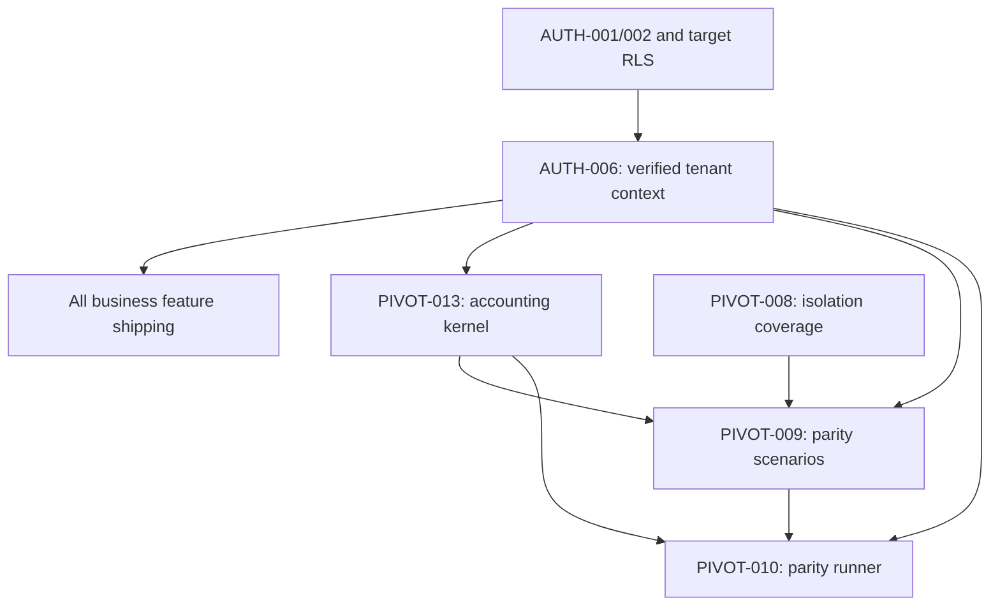

# Project state

15 November 2026. Engineering session only: proposed ADRs, source inventory and22 future task contracts. Implementation, acceptance evidence, deployment and client migration are not delivered here.

## Observed source and existing work

Integration base43dce30b8a83dbf7f1842e529008ec4a8229dc75; reviewed main sourceb9bdf75824b017cd813f55245f3c352d786fa864. Active native source is public/live plus src/local; identity/commerce/fleet/jobs use separate local SQLite stores and each subscribed business has a tenant file. Journals, saved drafts, numbering, rejection/return, trial/GL, bounded invoice/bill/settlement/credit and weighted-average stock flows exist. Accounting, Settings, approvals UX, statutory statements, inventory breadth, Apps, Private packaging and broader MVP work remain partial. PostgreSQL reference code/migrations under src/, scripts/ and postgresql/ are retained; db/postgres/ is a new, unimplemented target.

Existing auth uses scrypt, hashed opaque eight-hour app/operator sessions, CSRF/exact origins, active membership/role checks and operator scopes. Native MFA, passkeys, email verification/reset, OIDC and CF Access JWT application validation are missing. Better Auth is the proposed default; a dedicated auth ADR must define plugin/schema/session adaptation before implementation. RLS will reinforce tenant isolation, not replace business permissions, approval policies, owner protections or support consent.

## Current gate and session scope

SQLite remains production. The owner authorizes a controlled shared-PG design, not cutover. Retirement requires financial/security parity, enforced RLS coverage, independently timed PG restore and explicit owner authorization. New testapp/testops URLs are target specifications only; no infrastructure changes are made. Existing145-test/CI evidence belongs to the native baseline, not PG. This session executes no verification gates and does not update BUILD_STATE or produce07-verification-evidence.md. Later PIVOT-012 owns implementation evidence.

## Contradictions and narrowing decisions

Detailed observations are in00-engineer-reading-log.md. The new PG target supersedes the SQLite-only target clause only through the proposed ADR and required AGENTS annotation. New pending-document editing/AI approval rules differ from current immutable accepted commands and must use versioned submissions with approval invalidation. Operator Access/IdP MFA is distinct from tenant-local MFA and Private local administration. Old UI/module priority and hosted-AI language are historical; no product scope is removed. Tenant UUID mapping, composite tenant foreign keys, actual per-source posting states, operator permission/consent and rollback-resistant failure audit require explicit contracts. The prompt omitted the referenced auth-audit template, so item8 derives a complete observed-control matrix from its canonical constraints.

GitHub rejected testing-1/codex/postgresql-engineering-20261115 (422; ref prefix collision). Actual isolated branch is codex/postgresql-engineering-20261115. Human merge remains mandatory. No main/integration history is rewritten. A real independent Git checkout is used, leaving the prior materialized workspace and its unrelated differences intact.

## Status

Items are committed separately in the required session order. The initial item2 checkpoint deliberately omitted the graph; the item12 section below is the final dependency graph. Contracts describe future gates and exact allowed files; no green gate or completed pivot is claimed. Runtime, existing migrations, tests, frozen testing frontend and credentials remain unchanged.

## Item11 committed-output check

Observed git status --porcelain was empty at7a75ac69a94a3c84708abc75b0a1341ad22902e2 after item10. All30 required documentation files are tracked: reading log, project state, conventions, original pivot spec, storage/auth ADRs, full source table-purpose map, auth audit,10 AUTH contracts and12 PIVOT contracts. AGENTS has only the required pivot annotation. PIVOT-001 is the storage ADR, not a duplicate contract. No runtime, migration, test, archived-frontend, BUILD_STATE or verification-evidence implementation file is changed by this session.

The conventions contain the exact EXTENSIBILITY MANDATE and HARD PROHIBITIONS, and the stored pivot spec matches the supplied source verbatim (including its markers). This is document/Git inspection only; no scripts/check.mjs, test suite, parity, generator, RLS query or contract DONE WHEN gate was executed. Existing baseline CI counts are not PG evidence. This item11 record is committed separately; item12 adds the dependency graph, then item13 stops without reviewing or running a contractor task.

## Item12 dependency graph

Dependencies below govern future human-assigned implementation and acceptance. No contractor task is executed here. Schema/interface drafting may overlap where files are disjoint; no business feature is shipped/integrated, and no real parity acceptance occurs, before AUTH-006. PostgreSQL schema/auth preparation is a prerequisite to that context gate, not a bypass of it.

### Exact prerequisite table

| Contract | Direct prerequisite / acceptance gate | File-ownership or scope constraint |
| --- | --- | --- |
| PIVOT-002 | Proposed ADR01 and02 inventory | Bootstrap root: new roles/operator SQL and disposable PG fixture only; no existing PG migration edits |
| AUTH-001 | PIVOT-002 roles/operator tenant bootstrap | Canonical auth SQL, package pins and auth fixture; schema planning can overlap PIVOT-003 |
| PIVOT-003 | PIVOT-002 | Business/rule tables only; skeleton cannot serve requests before RLS |
| PIVOT-004 | PIVOT-003 and AUTH-001 | Complete tenant/auth scope, composite FKs and RLS; fixture context is not an application auth bypass |
| AUTH-002 | AUTH-001 | Own initial auth server/session-store/routes; no active native entry-point replacement |
| AUTH-003 | AUTH-002 | Own password/rate modules and routes after002 |
| AUTH-004 | AUTH-003 | Own factor/session/routes after003; tenant-admin assurance before business login |
| AUTH-005 | AUTH-004 | Own recovery/mail/session/routes after004 |
| AUTH-006 | AUTH-001/002, AUTH-005 shared-route completion, PIVOT-004 | Verified session-selected membership and one-client transaction context; gates every business feature ship and both parity contracts |
| AUTH-007 | AUTH-006 | Access/subject mapping; shared routes after006; Private local admin remains independent |
| AUTH-008 | AUTH-001 | Schema-only test file; may run alongside002..007 and PG schema work without shared edits |
| AUTH-009 | AUTH-002..007 | Audit instrumentation touches their shared modules only after those owners release them |
| AUTH-010 | AUTH-001..009, including008 | Security docs/convention extension; preserve verbatim sections |
| PIVOT-005 | PIVOT-004 | Immutability payload040 and40-triggers dispatcher; actual source states, no nonexistent status field |
| PIVOT-006 | PIVOT-005 and AUTH-006 for acceptance | Exclusive40-triggers dispatcher after005; new immutable041 payload, never rewrite applied040 |
| PIVOT-007 | PIVOT-006 and AUTH-007 | Verified operator identity plus scoped current customer consent; safe definer ownership/search_path/audit |
| PIVOT-008 | PIVOT-007, AUTH-006/007 and preceding schema/trigger work | New explicit PG gate; native syntax path stays independent, required PG CI never silently skips |
| PIVOT-013 | PIVOT-003/004/005/006 and AUTH-006 | New accounting adapter namespace; preserve native semantics, explicit versioned pending/AI extension lane; must complete before009/010 |
| PIVOT-009 | Completed PIVOT-013, PIVOT-008 and AUTH-006 | Actual dual-backend scenarios with independent expectations; missing backend/scenario cannot pass |
| PIVOT-010 | Completed PIVOT-009 and PIVOT-013, plus AUTH-006 | Runner/report after scenario files; nonempty diff or incomplete run exits nonzero |
| PIVOT-011 | PIVOT-002/ADR profile design | Runbook drafting independent of code; no performed-drill claim or owner signature |
| PIVOT-012 | All AUTH-001..010 and PIVOT-002..011/013 deliverables | Only this later contract executes full gates and writes evidence/BUILD_STATE; failure outside TOUCH returns to engineer |

### Permitted parallel lanes

After PIVOT-002, AUTH-001 and PIVOT-003 may be developed in parallel; PIVOT-004 waits for both. AUTH-002..005 can proceed while PIVOT-004/005 are completed on separate files. AUTH-008 and the unsigned PIVOT-011 runbook are independent once their prerequisites exist. After AUTH-006, AUTH-007 then AUTH-009/010 may proceed alongside new PG kernel work; PIVOT-013 starts acceptance only after PIVOT-006 is complete and can then overlap PIVOT-007/008. Parity waits for both the completed kernel and isolation coverage, never a stubbed kernel. Human assignment/merging controls these lanes; no agents/models/orchestration are launched here.

Shared files are serialized: auth routes/session modules across AUTH-002..007 and009;40-triggers dispatcher and db/postgres/README across PG schema/trigger contracts; parity README/fixture contracts before runner. AUTH-009 and010 must coordinate src/auth/README ownership. AUTH-001 package pinning is exclusive. Closed TOUCH lists are not permission to overwrite another unmerged branch; out-of-scope needs a revised contract. Before each merge inspect the source diff and invariants, not just gate logs.

### Final session state

STATUS: COMPLETE ? engineering documentation/contract session only.
COMPLETED: items1?12, each in a separate commit, pushed on codex/postgresql-engineering-20261115 (recorded Git ref naming exception).
STOP: item13 ? wait for the human; do not execute a contract or review a contractor diff until the human returns one.

No application gate, migration, parity run, restore, deployment, main/integration merge, model invocation or actual business posting was performed. No new07-verification-evidence.md or BUILD_STATE update was created. SQLite remains production, all proposed ADRs remain Proposed, and owner migration/cutover authorization remains a future gate. The branch is intended for human review/merge; no claim of a completed PostgreSQL/auth pivot is made.
