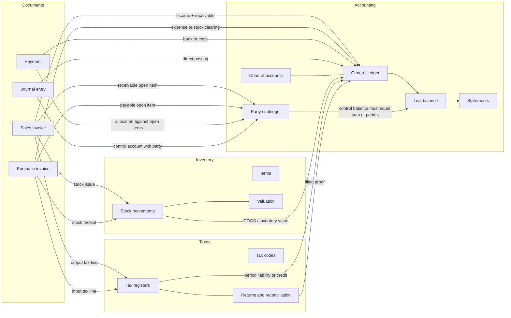
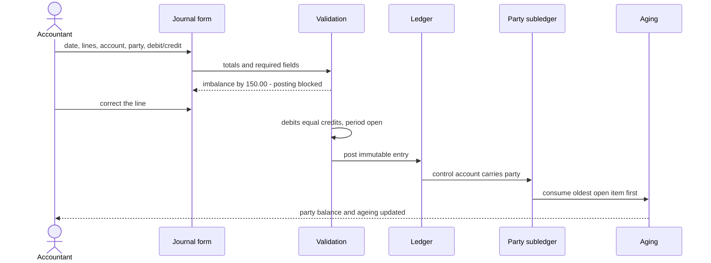
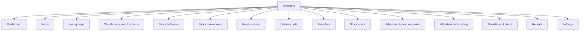
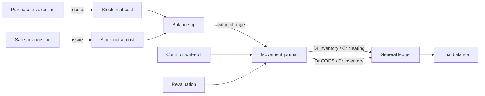
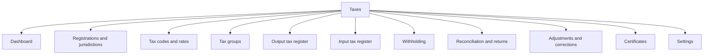
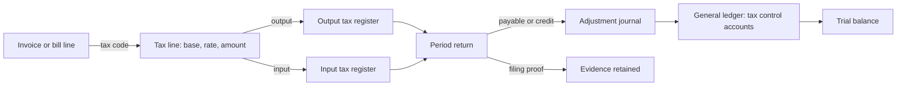
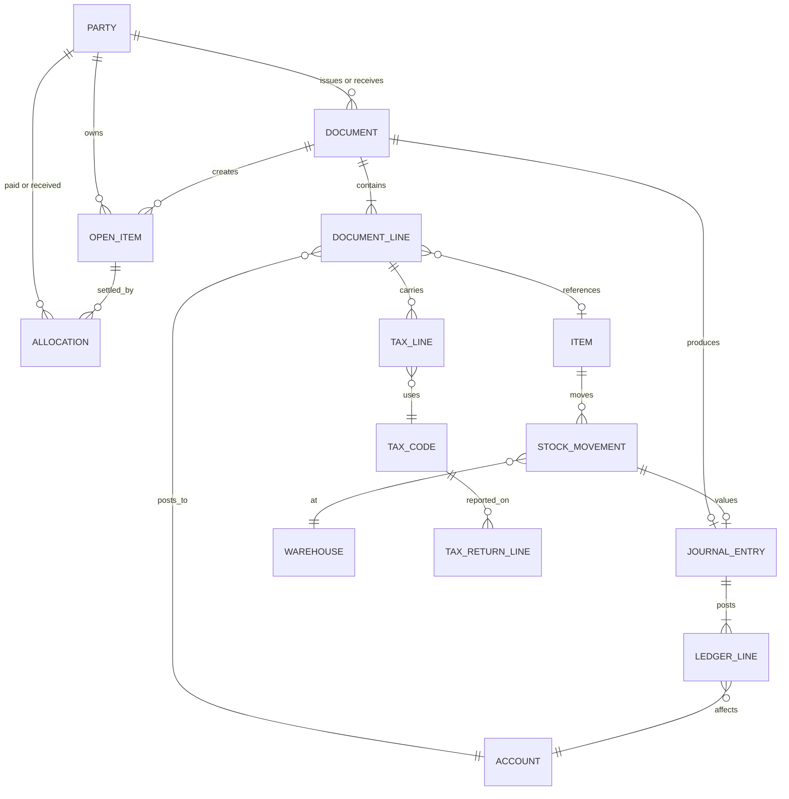

> **Superseded page/navigation state (28 November 2026).** This file is retained for the
> original module boundaries and document flows. It still shows Taxes as an Accounting
> page with five tabs and does not include the later Advances/Purchase bills changes.
> The current build has **Taxes as a top-level module** with Rules, Authorities, Tax
> ledger, Parties, Tax entry and Default accounts. For the current page register read
> `MODULE_PAGES.md` and `SYSTEM_LOGIC_MAP.md`; for the tax flow read
> `CHECKPOINT-2026-11-28.md`.

# SAVEN module map — Accounting, Inventory, Taxes

> Readable, comment-friendly version: `MODULE_MAP.md` (revision 2 is authoritative). This file keeps the
> diagrams for visual reference.

The three modules a service business or a trading business cannot run without.
Everything else (Selling, Buying, POS, Manufacturing, Payroll) is workflow layered
on top of the same documents: an invoice, a payment, a stock movement, a tax line.

Legend for every table: **built** = working screen in the design build ·
**partial** = a working screen exists but covers part of the page · **planned** =
mapped here, not built.

---

## 1. How the three modules fit together

---

## 2. Accounting

### 2.1 Navigation

```mermaid
flowchart TD
  A["Accounting"] --> D["Dashboard"]
  A --> J["Journal entries"]
  A --> PN["Parties"]
  A --> AR["Receivables"]
  A --> AP["Payables"]
  A --> AG["Aging"]
  A --> RG["Registers"]
  A --> GL["General ledger"]
  A --> COA["Chart of accounts"]
  A --> TB["Trial balance"]
  A --> ST["Statements"]
  A --> PY["Payments"]
  A --> BK["Banking and cash"]
  A --> IT["Items"]
  A --> SI["Sales invoices"]
  A --> PI["Purchase invoices"]
  A --> APV["Approvals"]
  A --> CL["Period close"]

  J --> J1["Register"]
  J --> J2["New journal - full page form"]
  PN --> P1["Party register"]
  PN --> P2["Party ledger and limits"]
  AG --> A1["By party"]
  AG --> A2["By document"]
  BK --> B1["Accounts and cash flow"]
  BK --> B2["Account register"]
  BK --> B3["Reconciliation"]
```

### 2.2 Pages

| Page | What it does | Reads | Writes | State |
|---|---|---|---|---|
| Dashboard | Position, work waiting, fastest route into each workflow | ledger, subledger, registries | nothing | built (being reworked) |
| Journal entries | Register of every journal with state, source, party and totals | journals | nothing | built |
| New journal | Header + lines, party on control accounts, running totals, imbalance block | chart, parties | journal, ledger, subledger | built (needs party field) |
| Parties | Customers and suppliers: terms, limits, balances, status | subledger | party master | planned |
| Party ledger | Opening → documents → allocations → closing, credit-limit warnings | subledger | nothing | planned |
| Receivables | Exposure by customer, limit usage, oldest item | subledger | nothing | built |
| Payables | Exposure by supplier, due focus, holds | subledger | nothing | built |
| Aging | Buckets by party **and** by open document | subledger | nothing | built (party only) |
| Registers | Sales / purchase / payment / journal registers by party and period | documents | nothing | planned |
| General ledger | Account or all accounts, running balance, import | ledger | opening entries | built (no import) |
| Chart of accounts | Tree, nature, control flags, add / regroup / archive, import | chart | chart | built (no import) |
| Trial balance | Opening, movement, closing Dr/Cr, zero difference | ledger | nothing | built |
| Statements | P&L and financial position from the same ledger | ledger | nothing | built |
| Payments | Receipts and payments with an allocation table | parties, open items | payment, allocation, ledger | planned |
| Banking and cash | Accounts, cash flow, register, reconciliation | bank, ledger | reconciliation | partial |
| Items | Light item master with accounts and inventory flag | items | items | planned |
| Sales invoices | Customer invoice → receivable open item | items, tax | invoice, ledger, subledger, tax | planned |
| Purchase invoices | Supplier bill → payable open item | items, tax | bill, ledger, subledger, tax | planned |
| Approvals | Queue, review, approve / return / reject | documents | decision | built |
| Period close | Checklist, proof, evidenced lock | everything | period lock | partial |

### 2.3 Posting a journal line

**Rules**

- A control account (trade receivables / payables) cannot be posted without a
  party in a journal, and never directly from a document line.
- Party balance = sum of its open items. Any difference against the control
  account is shown as an error on the dashboard, not hidden.
- Allocation order for a manual journal is oldest due date first. Payments can
  override this explicitly.

---

## 3. Inventory

Inventory exists so that stock value and cost of sales are correct. It never
invents a value the ledger cannot explain: every movement posts, or is valued by
a schedule the ledger can reproduce.

### 3.1 Navigation

### 3.2 Pages

| Page | What it does | Reads | Writes | State |
|---|---|---|---|---|
| Dashboard | Stock value, low stock, movements today, slow movers | movements, items | nothing | planned |
| Items | Code, name, unit, category, income/expense/inventory accounts, tax, tracked flag, reorder point | chart, tax | item master | planned |
| Item groups | Tree used for reporting and default accounts | items | groups | planned |
| Warehouses and locations | Stores, bins, branch mapping, default accounts | branches | warehouses | planned |
| Stock balances | Quantity and value per item and warehouse, with last movement | movements | nothing | planned |
| Stock movements | Every in/out line: date, item, warehouse, quantity, value, source document | movements | nothing | planned |
| Goods receipt | Receive against a purchase invoice or order; batch/serial optional | bills | movement, ledger (clearing) | planned |
| Delivery note | Issue against a sales invoice; cost leaves at the costing method | invoices | movement, ledger (COGS) | planned |
| Transfers | Move quantity between warehouses without changing total value | movements | movement | planned |
| Stock count | Physical count sheet, variance, approval, adjustment posting | balances | count, adjustment | planned |
| Adjustments and write-offs | Damage, expiry, NRV write-down, with reason and approval | balances | movement, ledger | planned |
| Valuation and costing | Costing method per item, revaluation, landed cost allocation | movements | valuation | planned |
| Reorder and alerts | Items below reorder point, suggested quantities | balances | nothing | planned |
| Reports | Stock ledger, movement summary, valuation, ageing, gross margin by item | movements | nothing | planned |
| Settings | Costing method, default accounts, units, negative-stock policy | chart | settings | planned |

### 3.3 Stock to ledger

**Rules**

- Quantities are integers or three-decimal quantities; value is always decimal money.
- The inventory control account equals the sum of item balances. A difference is
  an error, never an adjustment of convenience.
- Negative stock is refused unless the company explicitly allows it, and then it
  is flagged on every affected report.
- An item is only valued when it is marked *inventory tracked*. Untracked items
  post straight to expense or income and never appear in stock balances.

---

## 4. Taxes

Taxes exist so that the returns can be produced from the ledger, not rebuilt in a
spreadsheet. Every tax line carries the code, the rate, the base and the
jurisdiction, so a return is a query.

### 4.1 Navigation

### 4.2 Pages

| Page | What it does | Reads | Writes | State |
|---|---|---|---|---|
| Dashboard | Liability or credit by period, next filing, unreconciled tax lines | tax lines | nothing | planned |
| Registrations and jurisdictions | Tax identities, jurisdictions, effective dates, filing frequency | company | registrations | planned |
| Tax codes and rates | Code, rate, inclusive or exclusive, base, accounts, effective range | chart | codes | planned |
| Tax groups | Combine codes for a document (e.g. standard rate + withholding) | codes | groups | planned |
| Output tax register | Every sales tax line: date, document, party, base, tax, code | invoices | nothing | planned |
| Input tax register | Every purchase tax line, with recoverable and blocked portions | bills | nothing | planned |
| Withholding | Withheld from suppliers and by customers, expected vs actual, certificates due | payments, certificates | nothing | planned |
| Reconciliation and returns | Period return: output, input, carried forward, payable; lock and proof | registers | return, ledger | planned |
| Adjustments and corrections | Manual tax adjustment with reason, approval and evidence | registers | adjustment, ledger | planned |
| Certificates | Issue and receive withholding certificates, link to documents | withholding | certificate | planned |
| Settings | Rounding, inclusive pricing, default accounts, filing periods | chart | settings | planned |

### 4.3 Tax to ledger

**Rules**

- A tax line always stores base, rate and amount. Never derive the amount from a
  rounded total; derive the total from the lines.
- Inclusive prices are back-calculated and the residual is posted to rounding, not
  absorbed silently.
- The tax control account equals the sum of unreconciled tax lines for the period.
- A return is locked with a snapshot; a later correction is a new adjustment with
  its own evidence.

---

## 5. Shared entities

| Entity | Key fields |
|---|---|
| Party | id, type, name, group, tax id, currency, terms, credit limit, status |
| Document | id, type, date, party, currency, due date, state, source |
| Document line | account, item, description, quantity, rate, amount, tax group |
| Tax line | code, base, rate, amount, jurisdiction, recoverable |
| Open item | document, party, amount, due date, outstanding, bucket |
| Allocation | open item, payment, amount, date, mode (oldest / newest / manual) |
| Journal entry | number, date, source, state, lines, reversal of |
| Ledger line | account, party, debit, credit, period, entry |
| Item | code, name, unit, accounts, tax, tracked, reorder point, costing |
| Stock movement | item, warehouse, quantity, value, direction, source |

---

## 6. Who writes what

| Action | Accounting | Inventory | Taxes |
|---|---|---|---|
| Post sales invoice | receivable, income, party item | stock issue and COGS if tracked | output tax line |
| Post purchase invoice | payable, expense or clearing | stock receipt at cost | input tax line |
| Post payment | bank, allocation, party balance | — | withholding if applicable |
| Post journal | ledger, party if control account | — | tax adjustment lines |
| Stock count | COGS or write-off | quantity and value | — |
| File a return | tax control accounts | — | return snapshot and proof |

Nothing outside Accounting writes to the ledger. Inventory and Taxes post through
journals so that every balance has a document behind it.

---

## 7. Build order

1. Journal entry form with party-aware lines (unblocks everything).
2. Chart of accounts: nature, groups, control flags.
3. Parties and party ledger.
4. Receivables, payables, ageing by party and by document.
5. General ledger and trial balance with filters.
6. Payments with allocation.
7. Sales and purchase invoices.
8. Items, then inventory movements and valuation.
9. Taxes: codes, registers, return.
10. Banking reconciliation.

---

## 8. Dashboard contract

The dashboard is the module's shop window. It must be evidence, not decoration.

**Must show, above the fold at 1280×800**

- Four figures with a stated basis: cash and bank, receivables, payables, result
  for the period. Each links to the page that explains it.
- What needs action: approvals waiting, drafts returned, unreconciled bank lines,
  overdue receivables — each with a count and a link.
- One trend that is real: cash movement for the period, drawn from posted entries.
- Recent activity: the last journals with amounts and state.

**Rules**

- No hero band, no decorative images, no marketing cards, no gradients behind text.
- No chart without a data source on the same page; no number without a period.
- Nothing that looks like a primary action is allowed to be decorative.
- Everything on the dashboard is a link into a page that can explain it.
- Density: two rows of content, not five. If it scrolls, the second screen must be
  work, not modules.
