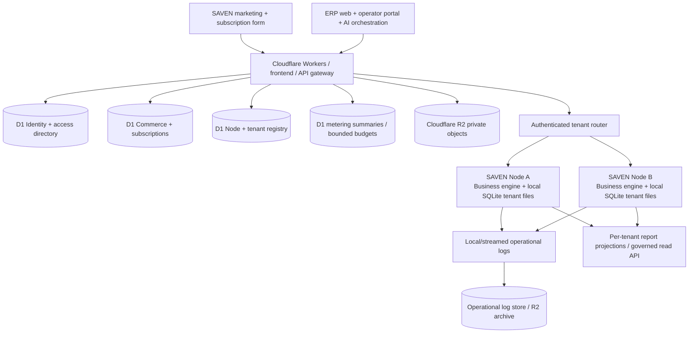

# SAVEN — FINAL ARCHITECTURE, PRODUCT DESIGN AND DEVELOPMENT MANDATE

**Edition:** Consolidated owner decisions, 13 November 2026 — **v2.0, supersedes the earlier master engineering directive and both follow-up prompts where they conflict**  
**For:** SAVEN development AI agent and engineering/security/accounting reviewers  
**Repository:** `abdullah2711/SAVEN` — development branch `testing-1`; `main` is the protected-in-principle production branch, though protection must be verified/configured.  
**Classification:** Engineering instruction and review baseline; **not** a claim that the specified capabilities are implemented, an instruction to make unapproved production changes, or authorization to purchase infrastructure.

> **Read the entire document.** Apply the owner's newest decisions over older proposals, preserve all agreed product families, and test the actual repository before changing it. The most important revisions are: **only TWO commercial deployment models; all-SQLite database family with Cloudflare D1 for SAVEN Cloud control-plane storage; tenant databases hosted on SAVEN-owned nodes only; fully private deployment of the same product; separate synchronized offline companion; frontend/UX-first design approval; rigorous central-vs-tenant permissions; segregated low-cost operational telemetry; and detailed SQLite reporting and fleet migration contracts.**

---

## 0. Authority, evidence, precedence and what is known

### 0.1 Scope and precedence

1. SAVEN is spelled **S-A-V-E-N** and pronounced *seven*. Simba is a historical project name, not current branding.
2. The owner's decisions and corrections in the discussion of 13 November 2026 govern this directive. The four supplied 11 November DOCX baselines (*Product Blueprint*, *Architecture AI and Security*, *Delivery and Verification*, and *Commercial Strategy and Sales*) remain source requirements except where explicitly superseded.
3. The previous file `SAVEN_MASTER_ENGINEERING_DIRECTIVE_2026-11-13.md`, and the two subsequently drafted installation/agent prompts, are superseded by **this single consolidated file**. Do **not** concatenate old prompts into instructions and accidentally reintroduce rejected deployment modes or PostgreSQL as a required target. Preserve their valid functional and assurance requirements, which are restated below.
4. Review fresh owner feedback in the current agent's conversation and work logs. Material that the agent cannot actually access must be marked inaccessible, not guessed. For every new instruction record source/date, interpretation, requirement ID, decision, implementation status and acceptance evidence.
5. The complete requested commercial capability catalog remains in scope. **Frontend-first changes the order of design and engineering, not the completeness or financial correctness standard**; no unimplemented screen counts as a working feature.
6. Never copy private passwords, personal API keys, server credentials, raw customer documents or privately provided competitor-system credentials into this repository, tests, issue comments or generated prompts. Access comparative systems only with explicitly authorized credentials through approved channels; do not embed such credentials into code or documentation.

### 0.2 Repository evidence at preparation time

The linked `testing-1` GitHub branch was inspected at commit **`da1bdb14880086f979cfaf33b7c90841b9bca8a0`** (13 Nov 2026 check). Its **Verify SAVEN** GitHub Actions run concluded **success**. The branch was 41 commits ahead of `main`; branch protection for `testing-1` was not enabled. The repository's build log reports PostgreSQL **schema 13 active on the testing host**, with **schema 14** (line invoices/configured basic taxes/defaults) in tested source but **not yet activated on the live testing server** because access was interrupted. Reinspect this status: repository evidence is not an independently refreshed server check.

Existing assets include Node/JavaScript application and Worker code, PostgreSQL schema/trigger/function-based accounting contracts, SQLite/D1 foundation harnesses, files/evidence service, sessions/passwords, invoice/stock/payment/approval/asset work and extensive `docs/` + `feature-catalog.json`. The catalog had **239 requirements** (48 in progress and 191 specified, none fully release-verified). Do not call a passing CI workflow proof of hosted deployment, full financial correctness, or completion of the broad suite.

Canonical existing documents: `AGENTS.md`, `README.md`, `docs/BUILD_STATE.md`, `docs/01-product-blueprint.md` through `docs/25-invoices-taxes-settings.md`, `docs/06-feedback-traceability.md`, `docs/07-architecture-decisions.md`, `docs/11-additional-input.md`, `docs/feature-catalog.json`, `tools/build_feature_catalog.py`, `tools/validate_plan.py`, `postgresql/`, `src/`, `public/`, `.github/workflows/verify.yml`.

### 0.3 Non-destructive development rule

All source changes start on **`testing-1`**. Do not merge or push to `main`, reconfigure production domains, run irreversible migrations, delete existing records, remove functioning tests, expose a server port, make paid purchases or deploy to production without explicit authorization. Prioritize creating the reviewed design library and technical contracts, using synthetic data. Use controlled staging and opt-in migration gates for any live testing database change. Keep an accurate checkpoint after every step, including work interrupted by model/session/network limits.

## 1. Product identity, commercial boundaries and deployment decisions

**Exactly TWO customer-facing commercial deployment models:**

1. **SAVEN Cloud:** SAVEN owns and operates the frontend, edge/application infrastructure, central D1 control-plane databases, Cloudflare R2 storage, and **SAVEN-controlled** SQLite tenant database nodes. Customers subscribe to a business account. A customer does **not** provide a database host, connection string, VPS or third-party node to attach to this shared service.
2. **SAVEN Fully Private:** SAVEN delivers and deploys the same software release family inside infrastructure **controlled by that customer** (on-premises, the customer's VPS/cloud account, or their own Cloudflare account where suitable). The customer owns the full installation: frontend, application/runtime, identity/control databases, business database(s), object storage and relevant workers. Deployment is performed and supported by SAVEN; it must be practically turnkey. The installed software must not depend on SAVEN Cloud for ordinary business operations.

**NOT permitted as a business model:** a hybrid SAVEN-hosted application with an individual customer-supplied business database node; accounting-firm/third-party-hosted databases; reseller-operated client fleets; a partner hosting tier. Do not reintroduce any of these from old drafts. Authorized accountants accessing several businesses are ordinary multi-business users, **not** a hosting or reseller model. Traditional referrals, where permitted commercially, do not grant any special hosting authority.

**Separate technical companion, not a third hosting model:** **SAVEN Offline**, a restricted local application for retail, POS, bakery/manufacturing sites, warehouses, construction sites and poor-connectivity operations; it synchronizes to the parent business's authoritative main database whenever a connection is available. Offline installations are associated with SAVEN Cloud or Fully Private customers and have independent site/device and licence permissions.

**Private installation variants:** An entirely self-contained installation runs its **control databases as local SQLite**, with local tenant SQLite and local/S3-compatible objects. A private customer who explicitly chooses to use its *own* Cloudflare D1/R2/Workers may do so through a documented supported profile. That profile is **Cloudflare-dependent** and therefore not air-gapped. It still belongs to the Fully Private commercial model because all components and cloud accounts are customer-controlled. Never claim Cloudflare D1 runs as a local database server in Docker. An on-premises installer must not require Cloudflare.

## 2. Non-negotiable product data hierarchy

Define and consistently implement these distinct entities:

- **Platform installation**: SAVEN SaaS or a customer's independent private deployment.
- **Tenant / subscribed business account**: subscription, entitlement, privacy and primary physical data-isolation unit.
- **Legal company**: independent accounting entity with its own books, fiscal periods, currency, tax registrations, chart, and reporting; a subscribed tenant can hold **multiple** legal companies if the product/plan allows it.
- **Branch / store / warehouse / site / department / project / cost centre / POS profile**: operational or analytical dimensions within a legal company.
- **Global user identity (within an installation)**: login credentials and sessions; membership permits access to specific tenants/companies, not a blanket authorization to all data.
- **Ultimate business owner**: protected highest-level business administrator, with special ownership transfer rules.
- **Operator**: SAVEN support/operations staff with separate role, MFA, attributable scoped access and independent logs.
- **Offline registered installation**: distinct device, site, scope, event queue and synchronized authority/entitlement policy.

**Default physical unit:** one SQLite database per **tenant/subscribed business account**, containing one or more legal companies. This is a proposed default, not a license to assume every tenant is a single legal company. Record a final architecture decision on whether a tenant's related legal companies must share one database for atomic intercompany effects. For a fully private customer with one business, provision one business DB; multiple legal companies within that private customer's subscription can still reside within it. Do not automatically equate one login, one legal company and one SQLite file.

A tenant's identity, placement, status and plan live in central control data; its actual accounting, stock, party masters, resource-level permissions and operating history live in the tenant database. Object content is separate from both, linked by verifiable metadata.

## 3. Selected SAVEN Cloud topology — the architecture to target



This is a **logical topology**, not a requirement to create four D1 databases before evidence supports it. The exact split follows aggregate consistency and measured write load. The frontend, authentication/API gateway, subscriptions and operator screens can reside on Cloudflare Workers/static assets. **The actual business transaction executor must run beside its SQLite files on the SAVEN-owned node**; the edge must not turn a 20-statement posting into 20 cloud-to-node network round trips. Send a single typed authenticated business command and complete the SQL transaction locally. Heavy, stateful ERP logic that exceeds Workers limits must remain in appropriately deployed node/application services; Workers may act as edge ingress/orchestrators.

**Crucial correction to the owner's bandwidth assumption:** Keeping R2 and frontend on Cloudflare reduces file-serving and frontend traffic on SAVEN nodes, but does not remove node internet needs. Every live business write, transactional read and detailed report still traverses a secure network boundary. If that node or connection is unavailable, the corresponding business's live service is unavailable, except for separately installed offline capabilities. Node internet throughput, round-trip latency, storage IOPS, power, failover and geographic placement must be measured and protected. Avoid placing all production tenant nodes behind a single unreliable personal-site link; maintain cloud/VPS fallback, reliable upstream, and failover policy.

**SAVEN Private topology:** Run the same frontend bundle, gateway/business service, local identity/control SQLite databases, local tenant SQLite, workers and object store on one or more customer-controlled hosts. Optional customer-owned Cloudflare bindings are an alternate private profile with clearly stated network dependence. No different application business rules or proprietary forks.

### 3.1 Storage responsibilities

| Data class | SAVEN Cloud location | Private equivalent | Critical transaction rule |
|---|---|---|---|
| User identities, password verifiers, global sessions, memberships | Central D1 identity/access domain | Local control SQLite | Atomic within owning DB; fail-closed authority |
| Subscription requests, billing, invoices and payments evidence metadata | Central D1 commercial domain | Local control SQLite | Durable workflow + audited outbox |
| Tenant location, node registry, schema readiness, placement jobs | Central D1 fleet domain | Local control SQLite | Fenced routing, idempotent provisioning |
| Plan entitlements, effective policy versions, suspended state | Central authoritative control aggregate; caches versioned | Local control SQLite | No unauthorised stale entitlement use |
| AI named seats, user/company budgets, cost summaries | Bounded control/metering storage with per-scope reservations; partition if measured | Local control SQLite / worker | Enforce budget before inference; reconcile afterward |
| Accounting, journals, inventory, POS, assets, tax, HR, projects | One SQLite file per tenant on SAVEN-owned data node | SQLite tenant DB(s) on customer host | Atomic posting within one tenant database |
| Business-specific roles, grants, item/party/store permissions, approval policies | Tenant SQLite | Tenant SQLite | Revalidated at command execution |
| Business authoritative audit/outbox/idempotency | Tenant SQLite; exported independent checkpoints | Tenant SQLite; customer-controlled independent backup | Must commit with business operation |
| Supporting documents, uploaded files, print exports | Private R2 | S3-compatible or protected local object storage | Immutable object versions, evidence manifest |
| High-volume diagnostics, request traces, infrastructure and AI performance telemetry | Stream/buffer to observability pipeline; archive to R2 or SAVEN-owned operations nodes | Local logging / customer-configured sink | Safe to batch/sample **noncritical** diagnostics; never sample regulatory/financial audit |
| BI aggregates/report cache/search | Tenant-local read models, optional rebuildable index | Local read models | Rebuildable, lag visible, no authorization bypass |

Do not confuse Cloudflare D1 (SQL) and R2 (object storage), or a Cloudflare SQLite-backed Durable Object with a D1 database. They are different services and have different APIs, costs and consistency models.

## 4. Permanent control-plane databases: logical domain separation and operational sharding

The owner's requirement for multiple permanent central SQLite databases is accepted **with a critical qualification**: split by clear ownership and required atomicity, **not** one new database per log type or module by default. D1 limits concurrency per database, but spreading logically coupled records across separate databases introduces non-atomic cross-database workflows. Multiple D1 databases in the same Cloudflare account share aggregate included billing allowances; each does not receive its own monthly free allowance.

### 4.1 Initial control-plane domains (proposed starting split)

**A. `control_identity` D1 (security-critical, comparatively low-write):** users, password-verifier versions, MFA and recovery metadata, sessions, login/device policy, operator identity, role grants, tenant membership, tenant existence and protected ultimate-owner references, grant revocations, authorization-policy version, security-event outbox. Keep immediately interdependent identity and membership invariants here. Authentication/permission checks must not rely on untrusted client-supplied company IDs.

**B. `control_commerce` D1 (commercial lifecycle):** marketing subscription applications, request history/status, pricing catalogue, quotes, invoices, manual payment evidence, upcoming gateway transactions, subscription ledger, renewal/downgrade/proration rules, commercial operator tasks, invoice/reminder jobs and transaction outbox. Store secrets in a secret-management service, not plaintext in billing tables.

**C. `control_fleet` D1 (placement and orchestration):** node registry, certificates/key identities, heartbeats as *aggregated* state (not every heartbeat as a separate permanent row), tenant-to-node mapping, ownership generation/fencing token, provisioning job/step records, schema fleet status, canary deployments, backup/restore status and operational upgrade approval.

**D. `control_ai` D1 or another bounded durable coordinator (only when required by workload):** named-seat allocations, immutable AI entitlement change history, per-user/tenant/model/provider budgets, usage summary checkpoints, consumed/remaining reservations, provider routing configuration references and non-secret chargeback metadata. If reservation contention or tokens-per-request causes too many D1 writes, use a keyed durable coordinator or sharded metering stores with consolidated immutable chargeable usage records. The exact design must be benchmarked and secure, not assumed.

**E. `control_security` (optional):** low-volume, mandatory operator/security decision records when their regulatory, access and retention characteristics justify isolation. However, events that must be atomically coupled to a change in identity/commerce/fleet must first be written **in that owning database transaction** to a local audit/outbox table, then exported to an independent audit archive. Never move the sole evidence of a critical event asynchronously without a durable source record.

Do **not** open dozens of D1 databases for low-traffic tables merely to appear sharded. Each D1's schema migrations, bindings, credentials and cross-domain coordination become another source of failure. Initially evaluate 3 core D1 databases plus a metering implementation if needed; derive actual split from measurements and atomicity requirements.

### 4.2 No cross-D1 atomic transaction

D1 `batch()` provides atomic work **within one bound D1 database**; it does not atomically commit across `control_identity`, `control_commerce`, `control_fleet`, R2 and tenant SQLite. Use explicit stateful processes (sagas) with transactional outboxes and idempotent consumer effects. Define states and recovery for at least:

`APPLICATION_RECEIVED -> REVIEWED -> PAYMENT_VERIFIED (if applicable) -> PROVISIONING -> TENANT_READY -> MEMBERSHIP_READY -> ACTIVE`.

Potential partial failure example: the commerce record says approved but the tenant database was not created. Never declare the customer active. Store a durable provisioning intent, retry creation with the same tenant ID/idempotency key, reconcile actual node state and only publish `ACTIVE` after all required authority and data are ready. Reconciliation worker and operator view must identify stuck/unknown states and allow safe resumption.

Plan changes produce a new approved version and effective time. The gateway consults authoritative tenant status/entitlement version, and the node rejects mismatched or expired authorization assertions. Suspension revokes new transaction authority without deleting historical books. In-flight work uses version checks and bounded leases.

### 4.3 Database choice and D1-specific constraints

Use D1's bound prepared statements; do not interpolate user input into raw SQL. Bind schemas for fixed central domains through environment configs (a handful of bindings). For the **tenant databases**, the SaaS choice is local SQLite on SAVEN nodes—**do not** create a separate D1 binding for every tenant. Use documented `D1Database::batch`, D1 migrations, query limits, 30-second SQL duration, 10 GB per D1 database and 50 MB response limits; benchmark peak query rate and manage cross-region consistency. Avoid serializing a million detailed AI events into a central D1 table.

Cloudflare D1 limits/pricing must be verified against current official documentation at deployment time. As checked in November 2026, Workers Paid D1 allows a maximum **10 GB per database** and **1 TB default account storage** (limit increase possible), with single-threaded query execution per individual D1; the plan's included 25 billion rows read and 50 million rows written per month are **pooled**. Additional storage is **$0.75/GB-month**. This does not imply the central control plane will consume those allowances; measure actual `rows_read`, `rows_written`, statement latencies, queries, indexes and daily peaks per domain. References: https://developers.cloudflare.com/d1/platform/limits/ and https://developers.cloudflare.com/d1/platform/pricing/.

### 4.4 Private equivalents without bespoke rewrites

Implement explicit **control-store ports** with well-defined transactional aggregates and a D1 adapter plus a native SQLite adapter. Build a versioned schema/migration contract for both. D1 Worker bindings are **not** substituted with raw filesystem paths. A private installer uses the same logical schemas but a local connection/transaction API; integration tests prove equivalent behavior under failed transactions, integer precision, foreign keys, ordering and concurrent requests.

A private installation may use separate local SQLite control files by domain, but a single-server small tenant can combine selected compatible domains into a smaller number of files if a documented migration strategy and consistency boundaries support that configuration. **Do not promise arbitrary runtime switching of individual domains between D1 and SQLite by changing one URL**; it requires an explicit controlled export/import, version, lock and reconciliation procedure. Keep installer profiles standardized and tested.

### 4.5 Central database outage behavior

Control-plane outage should not fabricate authorization. For normal cloud operations: deny new sign-ins, tenant activation, package or permission changes when central authority is unavailable. Existing authorized business sessions may be allowed restricted operations only under an explicit short-lived, signed, revocable lease policy that limits risk; sensitive admin, high-value posting, and rights changes fail closed. Require a separate, tested mode for **SAVEN Offline** devices with signed cached authority for approved scopes. Never silently bypass central subscription checks based on an old browser role string.

## 5. Authoritative security and permission model — who stores what

A user can belong to multiple customers; **membership does not equal transaction permission**. The access system has several cumulative dimensions:

1. **Platform authority** — operator vs ordinary user; only operator-specific scopes can manage registrations, plans, users or infrastructure. Operators require MFA, reason/case and audited support actions.
2. **Subscription entitlement** — whether the tenant has paid access to the selected module, integration, workflow, API, storage, offline device, AI model/seat etc. Operators can grant a documented exception; individual users cannot fabricate it.
3. **Tenant/legal-company membership** — central account login may see only explicitly permitted tenants/companies. A global user may be accountant in Company A and viewer in Company B.
4. **Business role and resource permissions** — **tenant SQLite authoritative**, including roles and grants, function/action, branch/store/item/party/account/project, limits, payroll/pay rates, record owner, view/modify/approve/post/export, column confidentiality and date constraints.
5. **Workflow policy** — conditions and required approvers, roles, levels, separation of duties, amount thresholds, evidence and exact policy version.
6. **Device/offline policy** — which offline installation and operator can create which entities and amounts, effective-time and sync restrictions.
7. **AI authority** — no different or higher role than the human user; the user's current effective permissions intersect with tenant entitlements, assigned AI seats, budgets and task safety policy.

### 5.1 Authority storage and execution sequence

**Central D1 identity:** user and operator identity, global session, tenant membership and active/suspended status, protected ultimate-owner identity, tenant/feature entitlement *source of truth*, and current revoked session identifiers. **Tenant SQLite:** business role assignments, record-level allow/deny and conditional policies, approval definitions, resource visibility and immutable access-change history. Replicate minimal membership/entitlement snapshots with monotonic versions to the node for efficient authorization, but **gateway AND node must check policy and scope**, and never silently accept stale rights after revocation beyond the explicitly authorized lease window.

Sequence for a business command:

1. Verify identity/session, device policy, CSRF/origin where applicable, and tenant selection at the gateway.
2. Check central active tenant status, membership and package entitlement; derive an authenticated, short-lived request assertion containing immutable actor/tenant/company, session, permission epoch, expiry, command type and correlation ID; do not trust the browser to assert them.
3. Route to the registered owner of the tenant SQLite file through mutually authenticated, encrypted service-to-service connectivity; verify audience, node identity, nonce/replay protection and request integrity.
4. Node verifies the assertion, current revocation/epoch/lease, **locally stored business grants and resource-specific workflow conditions**, record version and accounting limits.
5. Node executes the deterministic business command **in one local SQLite transaction** with audit, idempotency and outbox; returns only permitted fields.
6. Audit all denials and high-risk access changes. Background/AI/Apps/import/print/export routes must follow the *same* logic; no privileged hidden SQL path.

On membership revoke/suspend, deny immediately at the reachable central gateway and send a versioned revocation to the owning node. Node must reject outdated authority versions; if synchronization is unavailable, use a short bounded lease and fail closed for sensitive actions. A user changing business roles inside the tenant requires a locally atomic role update and policy-version change; gateway cache invalidation is explicit.

### 5.2 SQLite lacks native PostgreSQL RLS

Do not call this security design SQLite RLS. SQLite has no built-in PostgreSQL-style row policies. Use a single policy compiler plus server-side query building, parameterized predicates and result redaction, with never-exposed raw database credentials. Tests must call APIs directly as unauthorized users, manipulate company IDs, paginate restricted lists, invoke AI tools, trigger exports and attempt foreign-company joins. Hard constraints (company foreign keys, document/account mappings, journal balance, immutable posted records, uniqueness) remain in SQLite wherever feasible to survive application bugs.

Every permission-configuring screen must have an **effective-access simulator**: "As this user, can I read/post/approve/export this customer's transactions from this branch?"; include default deny and conflicting rule precedence. Define whether an explicit denial wins. Never use frontend hiding as authorization.

### 5.3 Ultimate owner, operators and identity

One protected ultimate owner per business; delegated admins cannot remove/replace them or create more admins unless the owner deliberately grants a specific right consistent with approved ownership policy. Ownership transfer needs step-up MFA, two-party review where possible, alerts and immutable evidence. An operator's support session is **attributed delegation** rather than login as a customer with password access. Existing passwords are never revealed; password reset rotates credentials and invalidates appropriate sessions. Use maintained password KDF (Argon2id where operationally supported; the existing scrypt implementation can be retained until a controlled security-reviewed migration), unique salts, secure sessions, one-active-session/account policy, MFA, safe recovery, IP/device abuse limits and secure secret storage. One active session is **not reliable hardware device attestation**; disclose limits.

## 6. Separate diagnostic telemetry from legal, financial and security audit

The owner is correct that naive per-click/per-token/per-query writes into central D1 could create load and costs. But **never solve that by dropping or sampling critical audit evidence**. Implement at least four distinct log classes and different pipelines:

| Class | Examples | Authoritative storage / durability | Collection policy |
|---|---|---|---|
| **Financial audit** | Journal posted/reversed, inventory released, period close, invoice correction, approved asset disposal | **Same tenant SQLite commit** as the source action; periodic independent sealed archive/checkpoint | Never sample, never best-effort |
| **Security/operator audit** | Permission/MFA/owner changes, operator support, licence and package change, sensitive export, delete/withdrawal | Atomic outbox in owning control/tenant DB; independent secured append-only archive | Never sample critical events |
| **Billable usage/metering** | Subscription events, AI tokens, named seats, paid device licences, API quota consumption | Durable metering ledger/reservations with reconciled provider receipt and chargeable summary | Never lose chargeable events; dedupe and settle |
| **Operational telemetry** | 2xx request stats, timings, source-map exceptions, query plans, retry spikes, health and AI non-sensitive performance | Bounded local/node log spool, Cloudflare observability/OpenTelemetry, R2 compressed partitioned archive or dedicated operations nodes | Batch, aggregate, sample high-volume successes; retain unsampled faults/security signals per policy |

Recommended pipeline: edge produces redacted structured telemetry with trace/span/correlation ID; noncritical telemetry may be aggregated in memory and delivered asynchronously to a private queue/observability service. Tenant nodes spool locally to a dedicated SQLite telemetry file or append-only structured files, with strict bounded retention, quotas and non-blocking backpressure. Periodic workers flush compressed daily/hourly partitions into R2; a query/index service retrieves targeted logs. An independent operational dashboard reads **summaries** (error rate, p95/p99, top failure code, provider cost, node lag) rather than scanning terabytes of raw log lines. For security critical events write authoritative durable records before acknowledgement, and independently anchor/retain audit digests off-node to detect local unauthorized changes.

Cloudflare currently supports Workers Logs and OpenTelemetry export/Logpush options; research exact retention, ingestion price, sensitive fields and supported destinations. References: https://developers.cloudflare.com/workers/observability/logs/workers-logs/ and https://developers.cloudflare.com/workers/observability/logs/logpush/.

**Privacy:** Do not put invoice images, passwords, session tokens, full prompts, account balances, customer names or document bodies in generic telemetry. Use hashed tenant/user identifiers where useful, restricted access, defined retention, erasure policies consistent with audit retention, and traceable access to logs. Security audit itself should be tamper-evident and independently access-controlled from ordinary operator staff.

**Costs:** Model monthly D1 read rows, write rows, 5-GB included + overage, Workers requests/CPU, Queues operations, R2 object/operation volume, node CPU/SSD/backup, telemetry ingest, AI, e-mail and support. D1 allowances are not repeated for every central DB. Emphasize cost per active tenant and cost per *successfully completed workflow*, not merely storage price. Trigger alerts before quota overrun.

## 7. Node ownership, tenant routing, provisioning and operations

A SAVEN-hosted SQLite node is a server/process group **owned or contracted directly by SAVEN**. It can run dozens or hundreds of business databases based on actual CPU, SSD I/O, RAM, writer-lock duration, tenant traffic, recovery capacity and growth—not an arbitrary fixed tenant count. Every business SQLite file gets precisely one active writable owner at a time; independent tenant files can write in parallel.

Node agent/service requirements:

- Accept only authenticated typed commands from the SAVEN gateway, with per-tenant authorization; **never expose SQLite database files, SQLite SQL endpoints, direct filesystem paths or administrative database credentials over public HTTP**.
- Execute the business command and read-model queries locally with safe read pools and one coordinated writer path per SQLite DB. Use SQLite WAL, `foreign_keys=ON`, suitable `busy_timeout`, `synchronous=FULL` initially for finance, vetted patches and crash tests.
- Register with `control_fleet`; report healthy/ready/readonly/degraded/draining/maintenance and a bounded recent performance summary. Periodic heartbeats should update state rather than append unbounded rows.
- Support automatic tenant creation, schema updates, safe signed artifact updates, snapshots/replication, encrypted backup, restore rehearsals, placement changes, fencing and promotion. Credentials/certificates are per-node, short-lived/rotatable, never shared root secrets.
- Enforce resource isolation for multiple tenants sharing a node: CPU/worker quotas, per-tenant memory/request limits, I/O limits, rate controls, priority and queue depth; one noisy customer must not starve the whole fleet.

### 7.1 New company provisioning (no manual SQL)

`SUBMISSION -> APPROVED -> PROVISIONING -> READY -> ACTIVE`; immutable tenant ID plus unique request idempotency. Fleet engine selects eligible node by capacity/region/health and writes a durable placement reservation. Node receives `CreateTenant(id, release, schema, bootstrap_manifest)` and creates its file under a secure generated path, applies all versioned schema changes, initializes the tenant/legal-company configuration, checks hashes, registers backup and verifies posting/query health. Control plane publishes routing **only after** readiness, user membership and entitlement activation are consistent. Failed steps retry safely or enter `NEEDS_OPERATOR`, without duplicate businesses or orphaned exposed files.

### 7.2 Adding, draining and moving nodes

Node registration requires explicitly authorized enrollment and attestation of appropriate software/certificate version, not just a database row saying it is available. Scheduling is capacity- and region-aware. For a move: snapshot/back up while source remains authoritative; prepare target; quiesce new source writes; reconcile all tail events; **fence old writable owner**; update registry generation atomically; activate target; run financial/stock/evidence/checkpoint verification; preserve source as read-only until recovery window passes. A timed-out request must not create split brain. If final committed deltas cannot be reconciled or fencing is uncertain, **fail closed** and require operator recovery.

### 7.3 Failure and availability reality

A normal SQLite file on one server is not automatically high availability. Define RPO/RTO per commercial tier. `synchronous=FULL` is local-disk durability, not protection against total host loss. A locally committed sale may be lost if the host dies before asynchronously transmitting changes. Near-zero-RPO financial claims require a validated synchronous, independently recoverable commit/replication mechanism—or a transparent, higher RPO commitment where the risk is accepted. Backups, WAL snapshots, copies, object manifests and encryption keys must be checked together. Test restorations, not just successful backup commands.

**Node connectivity:** benchmark end-to-end POS from Workers to data node and back on actual telecom links, including DNS/tunnel/TLS, concurrent users and document uploads. If personal premises hosting cannot meet uptime, network reliability or recovery goals, run SAVEN nodes in professionally operated VPS/data centers instead. Treat personal-server convenience as an initial engineering option, not an automatic SLA.

## 8. Automatic schema upgrades for thousands of SQLite tenant and control databases

This is not a future convenience; it is a **platform foundation requirement**. A new feature, module, index, account mapping, report projection, security rule or migration must not require manual SQL editing of every tenant database. Central D1 databases and each tenant SQLite file have **independent, versioned migration histories**.

### 8.1 Contract and recorded metadata

Define every schema package with:

```text
migration_id: immutable unique identifier
engine: control_d1 | control_sqlite | tenant_sqlite | offline_sqlite
from_version / to_version
minimum_compatible_app_version / maximum_compatible_app_version
minimum_compatible_offline_sync_protocol
prerequisites / dependent migrations
forward migration SQL or migration code digest
expected schema objects, indexes, foreign keys and triggers
preflight checks (disk, encryption, backup, journal balance, file hashes)
postflight checks (integrity, counts, financial reconciliation, audit/outbox)
strategy: additive | backfill | contract | rebuild
allowed downtime, batching budget and failure policy
release/artifact signature, author/reviewer, effective approval
```

Tenant DB records its own **`schema_migrations` ledger** (version, checksum, state, start/finish timestamps and results), so it can diagnose divergence from the central registry. Fleet registry stores reported version/status, expected target, migration job, node location and owner-generation, but a registry version alone is not proof that the file was upgraded. Compare actual database state with manifests. Store migration progress and resumable backfill cursors **in the tenant's own durable state**, not only in D1.

### 8.2 Zero-manual-intervention normal upgrade flow

1. Generate an immutable, reviewed release artifact plus signed migrations for both central D1 schemas and tenant SQLite. Verify with canonical unit/contract test fixtures and a previous-releases compatibility suite.
2. Run **preflight**: source and target versions, schema checksum, integrity check, available disk (including copy/rebuild overhead), backup freshness, locked maintenance operations, financial balance and object manifest references. Check that the application version understands both current and target structures.
3. Apply D1 central schema changes via dedicated orchestration/migration jobs with bounded batches (D1 large operations are subject to execution limits); avoid blocking login or invoicing. Backfill and data validation are separate checkpointed steps. If a central aggregate is unavailable, don't report commercial success prematurely.
4. Canary synthetic tenants; then internal tenants; then a small consented pilot fleet; then staged batches by node/region/tenant complexity. Require explicit rollback/abort thresholds and retain the ability to pause.
5. Node agents pull/verify the approved package and **serialize migrations per tenant**. Mark tenant `UPGRADING`; wait for in-flight business commands, optionally put only that tenant in read-only or maintenance state, take a transactionally consistent backup/snapshot, and run required SQLite migration transaction(s).
6. For schema changes that SQLite cannot perform safely as a simple `ALTER`, create a new table, copy and validate data, rebuild indexes/foreign keys/triggers, validate and swap using a reviewed transactional plan; preserve original row IDs and all historical monetary amounts.
7. Use **expand → migrate/backfill → contract**: introduce compatible columns/tables first; deploy code able to work with both old/new; backfill in small resumable chunks (with checkpoints); later remove old structures only after all relevant clients/offline versions are out of the compatibility window.
8. Run `PRAGMA integrity_check`, `PRAGMA foreign_key_check`, required `quick_check`, schema hashes, exact trial-balance/JL balance, AR/AP reconciliation, stock quantities/cost layers, asset controls, outstanding approvals, invoice numbering, audit/outbox counts and idempotency uniqueness. Compare to pre-upgrade snapshots, accounting for documented transformation expected values.
9. Commit upgrade success to tenant and report it to `control_fleet`; turn on new capability only if **entitlement + schema + runtime + dependency** are compatible. If any check fails, quarantine the tenant's upgrade and leave its route correctly disabled/old-version capable; other tenants proceed.
10. Emit immutable fleet migration evidence, latency, error, counts, costs and reversibility. Post-upgrade monitoring catches performance regressions and index-plan changes. Upgrade the offsite backup schema manifest and restore procedures.

### 8.3 Failed upgrades and rollback

**Never assume reverting the application container reverts data.** Before any new-format writes, a complete verified snapshot may support restoration under a controlled no-divergent-write procedure. After new-format writes or non-reversible transformations, use a *forward repair* or carefully planned reconciliation/cutover rather than overwriting newer records with an old snapshot. Idempotent chunk backfills must be restartable after node crash; a migration with unknown execution status must inspect state before retrying.

Backups must include the SQLite DB/WAL-consistent snapshot, object manifests, linked files/keys, schema and application version, migration journal, pending jobs, and verification digests. Snapshot and restore must not accidentally create a second writable live copy of the same tenant.

### 8.4 Offline clients and version skew

Offline installations can be disconnected for days or weeks while cloud nodes upgrade. Support an explicit **sync protocol compatibility window** (e.g. cloud accepts current and one or two tested prior protocols, with an exact supported duration decided by policy). Older client payloads are converted by versioned adapters into canonical commands. Do not require the latest UI schema inside old offline events; preserve old originals and validate them under effective-time policies. When protocol is no longer supported, stop normal sync safely and prompt a signed client update, **without deleting or abandoning unsynchronized local evidence**. Device updates and control-plane schema changes must be ordered with compatible rollout and recoverable states. Use a centralized compatibility matrix for `frontend`, `API`, `command`, `tenant_schema`, `control_schema`, `offline_schema`, `sync_protocol`, `print_template`, `Apps API`, `AI tool`.

### 8.5 Modules and schema lifecycle

A module's entitlement toggle **must not drop its tables or history**. New module deployment can add tenant schema objects fleet-wide as needed while enabling UI/functions only for entitled tenants. Alternatively, use safe on-demand provisioning for expensive optional projections with reliable compatibility checks. Capability retirement hides/disables *new operations*, not historical evidence. Store posting policy/tax/cost formula versions by effective date and document so old books remain interpretable. Module install/upgrade is not permission to change old financial balances.

### 8.6 Fleet scale acceptance

Simulate **1,000 tenant DBs** spread across at least three node processes with deliberately mixed initial schema versions. Run canary rollout, partial power loss, interrupted WAL checkpoint, disk-full rebuild, stale node owner, wrong migration checksum, and disconnected offline client tests. Report migration throughput, p95/p99 per tenant, time to pause a bad rollout, data-recovery proof, and zero unauthorized cross-tenant modification. Prove new tenants start at the current schema automatically. Later 10k/100k scaling must be driven by measured fleet workload, not an unsupported claim of limitless growth.

## 9. SQLite financial transactions, concurrency and data correctness

### 9.1 One canonical business-command kernel

Every form, AI action, import, scheduled job, integration, POS and offline sync invokes the **same deterministic business-command contract**. A command includes: schema/command version, tenant, legal company, authenticated actor and session/device assertion, source channel, idempotency key, expected record version, structured exact-value payload, correlation ID, effective date, evidence references and relevant policy version. **Do not let the client choose its own server-trusted actor/entitlement.**

Business rules calculate exact amounts/quantities independently of UI/AI; use well-specified scaled integers or correct decimal arithmetic, explicit currency rounding and overflow checks. SQLite's declared `DECIMAL` does **not** provide PostgreSQL `numeric` semantics; design and independently test monetary types, very large values, exchange rates, quantity decimals, tax rounding and conversions. No floating-point GL balances.

For one authorized posting, create in a **single SQLite transaction**: document state, business/subledger changes, balanced journal, stock/cost effects, approval outcome, immutable audit event, dedupe record, and transactional outbox. SQLite `CHECK`/triggers/restricted posting function equivalents should enforce critical invariants at commit. No orphaned stock issue or half-posted invoice. Posted entries are append-only; corrections are linked reversals/credit/adjustment. Locked periods/approvals and stock availability are rechecked at the final commit.

### 9.2 Fast path vs durable background path

For normal POS and interactive posting, the client waits for **committed durable success** through a bounded per-tenant single-writer coordinator with short lock windows; do not claim a sale posted merely because a job was enqueued. Use short local SQLite transactions and cache prepared masters safely. For imports, BI refreshes, bulk depreciation, mail, scheduled reports and AI extraction use a **durable job/outbox**, idempotent processing and bounded chunks that yield to interactive operations. Worker failure after commit/before acknowledgement retries the *same operation ID*; never duplicates the financial effect. Use `BEGIN IMMEDIATE` where appropriate, WAL on reliable local storage, monitored checkpoints, `synchronous=FULL` as the initial financial durability default and no unsafe shared-network-filesystem concurrent writers.

For 4–50 concurrent users per business, test 5/10/25/50 ms actual write lock duration and bursts of 50+ POS commands. User count is not writes per second. Report p95/p99 end-to-end latency (edge + node networking + waiting + lock + response) and sustained throughput; limit queue age and reject/degrade transparently on overload. Protect other tenant workloads on the same node. An import requiring all-or-nothing semantic treatment must stage then finalize appropriately rather than exposing partially posted books as a completed import.

### 9.3 Historic PostgreSQL correctness reference

The current PostgreSQL implementation includes functions, RLS, database triggers, period/stock restrictions and native contract tests. **Do not delete it at the start of the SQLite migration.** Create an inventory mapping each PostgreSQL table, trigger/function/constraint, approval rule, report and endpoint to a SQLite-compatible equivalent, identifying semantic differences and needed security enforcement. Run identical independently calculated business fixtures against old PostgreSQL and new SQLite, compare outputs and require sign-off. Data migration copies audited source snapshots to a new empty SQLite target, verifies every record/control balance/attachment link and switches only during a controlled planned test cutover; no dual writers. Do not disable PostgreSQL or mutate its historical records merely because a new UI was approved.

## 10. SAVEN Offline application and synchronization contract

Offline SAVEN is a **restricted operational application**, not a second full independent business portal and not a third commercial hosting product. Approved modules may include POS, local sale/purchase, inventory receipts/issues/transfers, recipes/small manufacturing, selected journals/payments, assets and other workflow actions required for branch continuity. The cloud/full-private main tenant database remains the **authoritative consolidated business book**. Cloud-defined access policies govern local creation/update of items, parties, accounts and other masters.

### 10.1 Offline workflow and state

The local client runs signed application binaries with encrypted local SQLite storage (e.g. a vetted SQLCipher-based implementation subject to licensing/maintenance review) and a tamper-evident append-only command/event log. Device/site has a registered key, tenant/company/branch/warehouse/POS identity, permitted users/actions, signed scoped offline licence, last policy/version and last acknowledged sync cursor.

- Local entry states: `LOCAL_DRAFT -> LOCALLY_COMMITTED -> SYNC_PENDING -> RECEIVED -> CENTRALLY_POSTED` or `SYNC_CONFLICT / REJECTED_WITH_REASON`.
- At local commit record immutable UUID/operation ID, device ID, monotonic device sequence, local posting/effective time and timezone, input evidence hashes, snapshot of policy/rate/price/unit mapping, optimistic master versions, dependent command IDs and exact local journal/subledger effect.
- On reconnect: mutual authentication + device lease/entitlement validation, uploads in bounded ordered/resumable batches, dedupe on operation IDs and content hashes, authoritative revalidation, cloud ACK with canonical IDs/versions and server cursor; download permitted master/permission/policy/stock updates back to device.
- Conflict **inbox** shows transaction, reason, both versions, financial effect, evidence and authorized reconciliation choices. Never silently overwrite an existing posted journal or quietly adjust opening balances. A site payment of 100 alongside a separate head-office transaction is not inherently a conflict; append both genuine payments, then recalculate the liability and check for actual duplicate, overspend, period closure or authority breach.
- Account for two offline terminals selling shared stock: allocate branch-owned stock or explicit reservations/quotas, warn on exhausted local available stock and define negative-stock policy. Once globally oversold, use an explicit documented correction/fulfillment process; never infer exact stock truth from disconnected branch balances.
- Offline menu must not support official standalone export/reports beyond scoped operational receipts and local continuity; official full business exports run through the main portal **after synchronization**. This is a supported feature boundary, **not** a technical guarantee that an owner of the device cannot copy its files/memory.
- Licence expiry must not destroy pending financial evidence. Design a documented grace/sync-recovery route without allowing unlimited unauthorized offline use. Online revocation is not instantaneous on a disconnected device; bound offline leases and transaction authority.

### 10.2 Mandatory offline acceptance cases

Bakery: recipe BOM ingredients consumed from designated store, finished output and POS revenue/COGS with linked sources, 100 sales while offline, correction, reconnect and reconciliation. Construction site: material issue, supplier/subcontractor payment, site labour entry, restricted new account creation, conflict with newly closed central period, duplicate upload, reversed/late ACK, and explicit operator-approved resolution. Separate devices: identical offline document number, out-of-order sequences, server crash after SQLite commit and before ACK, long downtime over several schema changes, malware in uploaded evidence and revocation while offline. All should retain original evidence, with no duplicate GL posting.

## 11. UI/UX-FIRST DESIGN CONTRACT — OWNER'S MOST IMPORTANT DEVELOPMENT SEQUENCE CHANGE

**Owner decision:** Build the **whole product's navigable and visually finished frontend blueprint first**, especially Accounting + Cash/Bank + Sales + Purchases + Payments + Inventory + Manufacturing + POS + Tax, and the other module families. Before implementing the bulk of backend logic, the owner will review whether every module's screens, workflow, details, settings, layout and interactions form a coherent attractive ERP. This is an explicit change to the old "build one real module then UI" sequence.

**Interpretation:** This is a **design-first prototype and review gate**, not permission to ship a deceptive mock as the production ERP or discard existing working backend functionality. The agent must keep existing tested paths intact, reuse data/command contracts and make an internally consistent prototype; avoid spending years rendering every hypothetical button before any real user testing. Complete the agreed screen/workflow library to owner sign-off in parallel with a minimal technical spike proving that the design can be implemented under the chosen data/permission model. **Do not use unfinished frontend elements to trigger real financial changes.**

### 11.1 Deliverables of the frontend-first phase

1. **Information architecture:** complete modular navigation, nested pages, settings, global search, favorites, recent actions, saved views, history/breadcrumbs, command palette and contextual AI entry point. Explicit Company → Branch/Site context, role workspace and permissions-aware visibility.
2. **Screen inventory and coverage mapping:** every requirement in the 239-item catalog and newly approved additions maps to one or more pages, modal/dialog, drawer, action, states and acceptance examples. Distinguish navigation/presentation vs workflow existence.
3. **Interactive design system:** components, tokens, spacing, typography, responsive grid, tables, forms, filters, grouping, drag/drop where appropriate, status/error chips, toolbar, transaction split-view, approval inbox, file/evidence preview, print preview, chart components and accessible light/dark modes.
4. **Module screen packs** in priority order: Accounting/COA/GL/Journals/Financial Statements/Close; Cash and Bank; Sales/AR/Invoices/Credits; Purchases/AP/Payments; Tax/Withholding/Returns; Inventory/Costing; Manufacturing/BOM/WIP; POS/Shift/Returns; Assets/Depreciation; Projects/Planning/Finance; HR/Payroll; BI; CRM; Drive; Apps; AI; company settings; operator administration; subscriber/marketing signup and billing; offline client/permission/sync/conflicts.
5. **Workflow prototypes:** navigation from record entry → line editing → evidence attachment → journal preview → policy decision → approval/direct posting → print/send → ledger/report drill-through; show all condition variants (credit invoice, paid invoice, permitted direct cash, discounts/taxes, etc.) with representative synthetic outcomes.
6. **Realistic table states:** zero/empty, sample data, filtering/search, results/permissions-denied, unsaved changes, validation failures, stale preview, offline/online, queued, loading, huge dataset/pagination, success/partial failure, conflict resolution, suspended subscription and inaccessible module.
7. **Source-backed user journeys and clickable prototypes** for owner, bookkeeper, storekeeper, factory supervisor, cashier, HR officer, tax specialist, CFO, operator and offline site clerk. Capture usability observations, screen/video walkthroughs, task-completion friction and owner approvals.
8. **No fake backend claims:** use clearly labelled `DEMO DESIGN DATA`, isolated route/feature-flag sandbox, deterministic synthetic fixtures, and disabled submit actions or explicit simulation; do not allow placeholder `Save`, `Send`, `Post`, `Approve` to succeed or imply real writes. Production app must never intermix demo records with actual ledgers.
9. **Backend-ready contracts:** field schemas, input/output examples, state transitions, validation messages, permission predicates, data dependencies, accounting impacts, chosen API/command shape and report/query specs are generated for each design **before** the feature is implemented. Design changes feed the requirement catalog and contract tests.
10. **Owner sign-off:** module and cross-module prototypes receive `DESIGN_APPROVED` with dated issues and screenshots; then backend implementation is scheduled. A working module is `IMPLEMENTED` only after native, end-to-end, financial, security, performance and deployment checks—not because the UX was approved.

### 11.2 Visual direction and external references

Reduce heavy blur, excessive glass panels, oversaturated accents and overly dense dashboards. Use a **comfortable warm-white/light-neutral** scheme and near-black/charcoal dark mode with **restrained plum** as the secondary/accent family, applied consistently. Clear typographic hierarchy and generously usable spacing are more important than decorative effects. Reference **https://wisprflow.ai** for its calm typography, navbar proportions, readable text and "Used by professionals at" treatment; **do not copy its copyrighted code, assets, trademark or unlicensed fonts**. Identify the actual font only if legally licensed and test legibility; otherwise use a comparable licensed typeface. Preserve a professional high-information-density ERP table mode for accountants alongside uncluttered beginner flows.

Use the owner's authorized **ERPNext** installation as a continual functional/UX reference—module structure, list views, document forms, cross-references, global search, report drill-down and configurable workflows—without copying proprietary customer content or committing login credentials. Evaluate ERPNext interactions, not just screenshots. Explicitly implement accessible full-product **global search/command palette** with scoped results across parties, invoices, vouchers, accounts, assets, items, reports and settings. Prefer discoverability, correct labels, contextual defaults, keyboard navigation, visible document lifecycle and stable sidebar to ornamental motion.

No indiscriminate "liquid glass" CSS blur. Any translucent/refractive effect must be restrained, evaluated for readability, reduced-motion and performance, and optionally disabled in large tables. Test mobile/POS touch targets, dark contrast, low-power devices, print formats and both keyboard and screen-reader journeys.

### 11.3 Sequence conflict resolution

For the initial design phase: create screens and interaction contracts across the suite, with the most effort in accounting/tax and connected business operations. Keep the existing PostgreSQL transaction service **as a safe working reference**; a separate SQLite architecture spike may be built in synthetic tests, not as a prerequisite to approving typography/layout. After UX approval, implement in dependency order: identity/tenant/scope, exact posting kernel, sales/purchases/payments/tax/inventory, and so forth. At every step integrate frontend state with the same validated command interfaces and acceptance tests. Do not postpone all database/authorization design until after UI completion: that would force large UX rework when real domain constraints become known.

## 12. DYNAMIC BUSINESS INTELLIGENCE AND REPORTING ON TENANT SQLITE — DETAILED IMPLEMENTATION

**Decision:** SQLite is a valid authoritative SME transactional store and can also support **dynamic, user-configurable dashboards**. The workload should be designed for indexed queries and **incrementally maintained read projections**, not repeated full ledger scans on each dashboard refresh. The owner accepts approximately **5–10 seconds of data freshness lag** for many management dashboards; this is not permission for the user interface to become sluggish or to display stale numbers as live books. Exact financial statements and decisions based on hard balances use a consistent authoritative snapshot.

### 12.1 Separate three read use cases

1. **Transactional drill-down**: accounts, journals, a voucher, payments, an inventory item ledger, customer balance, approval and source evidence. Queries against the tenant SQLite source tables using relevant indexes, bounded pagination and permissions. Very recent committed data is immediately authoritative.
2. **Operational/managerial dashboards**: sales today/MTD, debtor aging, stock levels, gross margin, branch performance, cash, project cost, manufacturing yield, AI usage. Read precomputed/incremental summaries and caches, with `as_of_event_seq`, snapshot timestamps and data freshness badges. Desired normal freshness target: p95 under 5–10 seconds (to be tested and revised by measured load), **not a blanket guarantee**.
3. **Heavy customized reports/statutory financial statements**: on-demand guarded read-only queries, report snapshot jobs, consolidation/elimination schedules and exact audited reporting packs. Run via resource-governed background workers and consistent snapshots; do not perform costly joins in edge Workers or hold SQLite's writer lock during report calculation.

### 12.2 Source ledger and fact model

Retain and normalize authoritative financial/business facts (names may differ from existing code):

- `journal_headers` / `journal_lines`: company, posting/effective date, period, account, debit/credit in minor units, currency/rate, source command, status, branch/project/cost-centre/dimensions; linked posted corrections.
- `invoice_headers` / `invoice_lines`, `payment_events` / `payment_allocations`, `stock_movements` / `cost_layers`, `production_orders` / `BOM_consumption` / `WIP`, `asset_events`, `payroll_postings`, `project_cost_events`, `tax_lines`, `resource_access_versions`.
- Dimensions: account hierarchy, legal company, branch, warehouse, project, department, product, party, item category, financial calendar, period, currency, user/owner where authorized.
- **Never derive real financial balances only from a UI tally or a mutable `account.balance` field without independent ledger reconciliation.** Every projection has source event lineage and rebuild logic.

Use `INTEGER` minor units or explicit exact-decimal strings plus deterministic value converters for financial values. Separate stored source currency, reporting currency, conversion and rounding; record the rate/time version used in transformations.

### 12.3 Canonical transaction outbox and exactly-once projection effect

In **the same SQLite transaction** that posts a business command, create a compact `business_outbox` event: immutable event ID, tenant/legal-company, global per-tenant monotonic sequence, kind, affected entity/period/dimension IDs, account/stock deltas or reference to authoritative rows, source revision, occurred/effective times and schema/event version. No external queue can replace the local committed outbox as the authoritative record of what needs to be projected.

A reporting worker reads events in sequence and maintains summary tables. It commits projection changes **atomically with the consumer progress cursor / applied_event ID** in the same tenant SQLite database. If it crashes after updating a summary but before an acknowledgment, the restarted consumer must not apply the delta twice. Use unique `applied_event` keys or cursor semantics validated against out-of-order processing, backdated transactions and partial rebuilds. Rebuilds must be reproducible from canonical source transactions or stable checkpoints plus the retained event stream.

A proposed schema sketch (not an instruction to create duplicate tables over existing ones):

```sql
CREATE TABLE report_projection_progress (
  projection_id TEXT PRIMARY KEY,
  version INTEGER NOT NULL,
  applied_event_seq INTEGER NOT NULL DEFAULT 0,
  last_success_utc TEXT,
  state TEXT NOT NULL
);

CREATE TABLE report_sales_daily (
  company_id TEXT NOT NULL,
  accounting_date TEXT NOT NULL,
  branch_id TEXT NOT NULL,
  currency_code TEXT NOT NULL,
  revenue_minor INTEGER NOT NULL DEFAULT 0,
  discount_minor INTEGER NOT NULL DEFAULT 0,
  tax_minor INTEGER NOT NULL DEFAULT 0,
  cogs_minor INTEGER NOT NULL DEFAULT 0,
  sales_count INTEGER NOT NULL DEFAULT 0,
  PRIMARY KEY (company_id, accounting_date, branch_id, currency_code)
);

CREATE INDEX IF NOT EXISTS idx_journal_company_date_account
  ON journal_lines(company_id, posting_date, account_id);
```

The actual schema must preserve current company/tenant constraints, exact money representation and indexes. Do not indiscriminately add indexes to every field; benchmark write amplification, WAL size and `EXPLAIN QUERY PLAN` for representative reads.

### 12.4 Projection catalog

Create versioned read models grouped by use case:

| Projection | Grain / keys | Source and integrity test |
|---|---|---|
| `gl_period_account_balance` | company, fiscal period, account, currency, branch/project optional | Journal lines, Dr−Cr and trial-balance comparison |
| `sales_daily` / `purchase_daily` | date, company, branch, item/category/customer where needed | Accepted invoices/credits/returns; avoid double-counting settlements |
| `ar_ap_aging` | party, due-date bucket, company, currency, as-of | Open invoice less allocated payments/credits/advances; recompute backdated effective cases |
| `stock_balance` | item, warehouse, lot/serial as relevant | Movements and valuation cost layers; quantity/value checks |
| `manufacturing_cost` | BOM version, production batch, WIP, output lot | Actual material, labor, overhead, scrap, loss, by-product reconciled |
| `project_financials` | project/WBS/cost centre, period | Actuals, commitments, revised budget, forecast-to-complete |
| `tax_workpaper` | jurisdiction, registration, effective period, tax type | Tax lines, withholding certificates and GL reconciliation |
| `cash_flow_projection` | cash/bank, period, counterparty/source type | Cash/bank movements and approved classification snapshots |
| `asset_rollforward` | class, month, asset | Register vs GL gross cost, depreciation, disposals |
| `hr_payroll_summary` | period, org/department with restricted access | Approved payroll run and liability settlement |

Project only required dimensions. A combinatorial cube with every party × project × item × user is wasteful; start with coarse aggregates and use scoped secondary queries/drill-through for sparse dimensions. New dimensions/metrics require catalog registration, validation, migration or projection rebuild where necessary.

### 12.5 Dynamic dashboard/report builder — the actual frontend/backend contract

Frontend provides **non-SQL report configuration**: select authorized dataset, measures, dimensions, grouping, date/period range, filter operators, sorting, top-N, chart/table/pivot, comparisons, fiscal/calendar basis, saved views, refresh cadence and schedule/email/export policy. The report definition is a versioned validated JSON/typed DSL—not arbitrary SQL, JavaScript, or AI-produced executable query text.

Example specification:

```json
{
  "version": 1,
  "dataset": "sales_performance",
  "measures": ["net_sales", "gross_margin"],
  "dimensions": ["accounting_month", "branch"],
  "filters": [{"field":"accounting_date","op":"between","values":["2026-01-01","2026-12-31"]}],
  "sort": [{"field":"accounting_month","direction":"asc"}],
  "limit": 240,
  "basis": "posted_only",
  "freshness": "managerial"
}
```

Backend **report compiler**:

1. Validate dataset and metric IDs against an allowlisted `report_catalog` with descriptions, calculation method, supported currency/period basis, confidentiality classification and required permissions.
2. Resolve user/tenant/legal-company scope on the server; intersect with branch/project/party/account permissions. **A precomputed all-company total must never reveal denied financial data.** Where coarse aggregates cannot be safely filtered by the user's resource rights, use authorized finer-grain projections or dynamically aggregate permitted source rows; do not serve a global total then hide drill-down rows.
3. Validate operator/filter/value types, allowed joins/dimensions, predicate selectivity, maximum result rows, time periods, joins and estimated cost. Compile only **parameterized, read-only SQL** over allowlisted views/tables. No unrestricted `SELECT` from client-supplied SQL and no raw AI SQL.
4. Choose source read table vs materialized projection vs cached previous result based on data freshness, complexity, index availability and quota. Use query planner and indexed predicates. Limit concurrency per tenant; expensive operations become async report jobs with progress and cancellation.
5. Use consistent read transactions/snapshot metadata, return `asOfUtc`, `sourceEventSeq`, `projectionEventSeq`, `lagSeconds`, dataset/version, security scope, currency/rounding/report basis, and `partial/stale/rebuild` warnings. A dashboard opening with an unavailable projection either uses a clearly labelled older result or falls back to a bounded direct query—not a silently made-up number.
6. Support drill-through `chart → filtered register → document → journal lines → evidence` without broadening permissions at each step. Paginated UI tables do not restrict full authorized report totals or complete scheduled exports.
7. Save report layout/definitions scoped by user/team/business, with version history, ownership, sharing, approval and entitlement. AI only proposes **the same validated report specification**, not a privileged SQL query.

### 12.6 Freshness, caching and backdated corrections

A report's **freshness age** is the difference between current committed source event sequence/time and what the projection has processed. Use per-tenant workers triggered by commit/outbox and periodic safety polling. The frontend may poll or subscribe to a change channel to refresh affected panels, with backpressure and a visible as-of label; avoid refreshing every widget every second across 1,000 tenants.

Reversal, credit note, retroactive wage, backdated journal, inventory cost adjustment and archived/reinstated document can affect **prior** periods. The event must list affected period/dimensions; apply inverse and new deltas, or mark the affected projection slices for deterministic recomputation. Version financial projections and take immutable snapshot packs at close; do not silently overwrite a published audited financial statement. A report cut-off at close retains its original policy/mapping versions and a traceable subsequent-adjustment history.

Cache keys must include tenant, legal company, permission scope hash/version, report definition version, source/projection watermark, time basis, currency and range. Permission revocation must invalidate the cache immediately or fail closed. Never cache a private HR or supplier pricing report under a globally shared key.

### 12.7 Separate reporting execution and capacity controls

- Keep detailed reads and projections beside SQLite tenant data to minimize per-query network chatter.
- Use dedicated low-priority reader workers or an authorized read-only snapshot/replica for heavy reporting, without letting long readers starve WAL checkpoints or interactive POS writes. Track WAL size and long-held transactions.
- If many tenants demand ad hoc analytics, move **derived** aggregates (not core GL authority) to a dedicated analytical service later, with verified permissions, event lag, recoverable exports and strong tenant isolation. This can be DuckDB or a columnar warehouse after benchmarking; it is **not** an MVP requirement or a replacement source of truth.
- Bounded execution: default report timeout, max scanned rows/CPU/memory, concurrency caps, cancellation, queueing and per-plan cost budgets. Operators can see query timings and slow-query fingerprints without reading private business rows.
- Never execute an unrestricted long-running report at the Cloudflare edge: return an authenticated job ID and poll/stream status. Save completed export to appropriately protected R2 objects with short-lived access links.
- Statutory packs and reconciliations must use **consistent canonical accounting snapshots**, not independently aged dashboard caches. Differences become visible reconciliation cases, never accounting plugs.

### 12.8 BI performance and correctness gates

Test synthetic 10k, 100k, 1m, 5m and larger journal-line tenants and high-cardinality branches/items/projects. Measure 4–50 interactive users with POS writes plus BI refresh and bulk imports. **Proposed, adjustable targets:** server-side p95 dashboard initial query under 1 second for projection-backed reports, common ledger lookup p95 under 2 seconds, normal managerial projection lag p95 under 10 seconds, and stable POS p95/p99 while a 5m-line historical report runs. These are **targets, not observed results or guarantees**. Measure network-included end-to-end p95 separately. Confirm exact GL vs summary balances, returns/reversals, effective-dated VAT/withholding, backdated corrections, closed-period snapshots, permission-safe aggregates, streaming full exports and no source record deletion during cache rebuild.

## 13. Fully private installation and turnkey release packaging

**Commercial model 2 is a full customer-controlled installation of the exact SAVEN product**, not a data-node connection to SAVEN Cloud. Deliver prebuilt signed versioned container images in a private registry or a customer-approved offline bundle. A licensed customer should not need access to the proprietary Git repository or to manually collect compatible services. Supported installer profiles:

- `private-local`: frontend/API/operator, native SQLite control-plane files, tenant SQLite, local/S3-compatible file objects, queues/workers, backup, licences and monitoring all inside the customer's environment. No Cloudflare requirement for ordinary use.
- `private-cloudflare`: the *customer's own* Cloudflare account for selected Workers/D1/R2 and the customer's local/VPS SQLite node(s). This is customer-managed cloud infrastructure, not a SAVEN SaaS/customer-provided-data-node hybrid. Clearly disclose its dependence on Cloudflare and connection availability.
- `saven-cloud`: managed SAVEN production profile as described in §3; **not a customer-facing third deployment offering**.

Provide repository `deployment/` or `ops/` packages with a complete Compose/private installation manifest, image version/digests, `.env.example`, secret initialization, first-admin wizard, health and dependency checks, automatic database creation, migration lock, resilient worker start, data volume mounts, backup/restore, upgrade/migration and `saven-doctor` diagnostics. Customer setup collects only domain/TLS configuration, initial authorized administrator, licence, storage and backup destination, and optional email/AI integrations. For customer-managed Cloudflare, gather account-scoped credentials via an approved secrets flow; no root API tokens in compose files or Git.

A clean supported machine must be installable without editing source code or manually creating SQL tables. Avoid hardcoded test hostnames (`economic-systems-server`), Cloudflare testing bindings, `saven-testing` container IDs, fixed production URLs and dev-only credentials in release scripts. Existing `Dockerfile`, `Dockerfile.postgres` and `scripts/deploy-server.sh` are **testing-focused starting points**, not proof that a turnkey installer exists.

A self-contained private install should continue processing accounting transactions during an internet outage; external licence verification, cloud AI, card billing and email may be unavailable, but must not corrupt business records. Signed licences have clear offline grace/recovery periods; a customer with root access cannot be guaranteed technically unable to modify client software, so rely on verifiable entitlement design, legal terms, code signing and tamper-evident controls rather than impossible claims of uncrackability.

Fully private upgrades use local schema migration/fleet orchestration on however many companies the private subscriber legitimately owns, and can receive controlled signed release packages without phoning home at every transaction. Test upgrades, audit exports, restore, rollback, key recovery and licence expiry/nonpayment preservation of historical records.

## 14. R2 and company Drive architecture

For SAVEN Cloud, R2 is the primary object store for attachments, exports, report packs, retained evidence, permitted media and selected independent backups. Business SQLite stores object metadata, legal-company/transaction links, content version/sha, scan state, quota, owner, retention and permissions. Use opaque keys and immutable versions, with signed short-lived operations after authorization; R2 presigned URLs are bearer-capabilities, not identity-bound permissions by themselves.

Design efficient direct-to-R2 authorized uploads where appropriate, followed by server-side checksum/type/size/virus scan, quarantine and only then activation. An upload is not valid support evidence until source metadata, content hash, scan state and linkage reconcile; failed SQL/objects are recovered via staging and garbage collection with safety holds. On deletion of an attached file, ordinary users must not erase financial evidence; controlled owner/admin withdrawal creates a tombstone, reason, notification and audit. Company-admin visibility into personal allocations must be disclosed. Full private variant swaps R2 for local/S3-compatible objects with equivalent retention and authorization contracts.

Keep backups off the same tenant node and include databases, R2/object versions, key and tenant registry manifests. R2's pricing is based on object bytes and operations, not just bandwidth; Cloudflare Standard R2 currently advertises no egress charges for R2, but file size, access, backups, Class A/B operations, retention and copies still cost money. See https://developers.cloudflare.com/r2/pricing/ and https://developers.cloudflare.com/r2/api/s3/presigned-urls/.

## 15. Threat model, cybersecurity and operational integrity

Security is a product requirement across source, deployment, edge, local tenant node, private installer, offline device, Apps and AI; **not merely an authentication page**. Commission independent review before commercial use, adopt an OWASP ASVS/API Security verification baseline appropriate to critical financial data, and make threat tests required CI/release gates.

### 15.1 Mandatory controls

- **Network:** TLS end-to-end; mTLS or strong mutually authenticated tunnel between Cloudflare gateway and SAVEN tenant node; no publicly exposed raw SQLite service/SSH/admin port; separate development/testing/production infrastructure; explicit origin/host allowlists, firewall and egress restrictions.
- **Authorization:** deny by default; no `tenant_id`/`company_id` trust from URLs without authority; server-side scope; separate operator identity; tenant-local resource policies; prevention of IDOR/BOLA across nested entities; short-lived access tokens; replay prevention; reauthorization for async jobs, signed file links, print and reports.
- **Inputs and queries:** parameterized SQL and typed canonical command DTOs; strict type/enum/range/unit/currency checks; safe sort/filter column allowlists; no client-authored SQL; HTML, CSV/spreadsheet formula and PDF/print injection controls; XSS/CSRF/CSP, SSRF protection for integrations/AI fetch, file path traversal/ZipSlip/zip-bomb protection.
- **Secrets and credentials:** password KDF with unique salts, safe session cookies, MFA for operators and business owner, access recovery audit, least-privilege service identities, secrets manager and key rotation, no shared operator password, no secrets in images/bundles/scripts/telemetry. Private customer installs have local key custody policies.
- **Data at rest:** tenant DB filesystem permissions, full-disk encryption and/or vetted SQLite encryption where threat model requires, encrypted R2/backups, off-node immutable backups, cryptographic key separation and recoverable key escrow/recovery policy, not plain local file copies on the same server.
- **Audit and tamper:** journal correction rather than edit; appended local financial audit, off-node signed/hash-chain checkpoints with independently retained roots, separation between operators who administer data nodes and those who can alter audit retention. A root administrator can still interfere with a customer-hosted private installation; document detection limits and contractual remedies.
- **Resilience:** harden containers (non-root, no unnecessary host mounts, pinned signed images, read-only roots where appropriate), dependency/SBOM/supply chain scanning, CI signatures, restricted CI secrets, required reviews, bounded jobs, service health/readiness, traffic budgets, WAF/abuse limits.
- **Apps/integrations:** signed manifest, sandbox and origin/egress isolation, granular scopes, API key vault, uninstall/revoke, capability contracts, no arbitrary customer code in journal engine; domain trust and webhook signature verification.
- **AI:** prevent prompt injection from documents and retrieved context from changing authorization; typed tools only, current user scope, budgets, evidence and policy approval; untrusted outputs cannot become financial postings without deterministic validation. Provider keys and private prompts must not enter telemetry.

### 15.2 Integrity and disaster recovery are separate from cybersecurity

For every business posting establish a client operation ID, canonical event, atomic SQLite commit, idempotency, durable outbox, and late-ACK reconciliation. Validate accounting invariants and control-account/subledger reconciliation continuously; alert on missing projections, divergence, orphaned attachments and WAL/checkpoint/backup errors. A successful HTTP response to the user means the transaction was **committed at the declared durability tier**, not merely accepted by a worker. Tell the truth about remote-node loss before asynchronous replication.

Define **SAVEN Cloud RPO/RTO** by service tier before launch, along with achievable backup frequency, off-node storage, restore drill and failover runbook. Restore by tenant, by node, and by complete platform installation. Central D1 point-in-time recovery is not a substitute for independent backups or consistency across multiple control databases. Recover central identity, entitlements, fleet mapping, object store and tenant DBs to a reconciled state; a snapshot of one database at 10:00 and another at 09:59 can create phantom activation or billing unless reconciled from durable saga/event state.

Implement detection and response for SQL injection, tenant ID enumeration, stolen tokens, compromised node certs, malicious partner Apps, ransomware, credential stuffing, account takeover, D1 service outage, Cloudflare account lockout, R2 bucket deletion, lost tenant node, offline compromise and insider operator misuse. Alert, contain, rotate credentials, preserve evidence, restore, reconcile, notify according to applicable law/contract, and document lessons learned. No claims of 100% breach-proof security.

## 16. Subscription acquisition, billing, operator portal and AI economics

### 16.1 Marketing-to-customer onboarding

SAVEN marketing site `https://saven.economicsystems.cc/` contains a professional applicant/package interface (may be separate static frontend) that writes validated submissions into the **commercial control database** via a protected API. The operator portal lists new/awaiting-info/approved/declined/billed/paid/provisioning/active/paused/cancelled applications. Capture business/contact/plan/company info **once** and convert an approved submission into a tenant identity, ultimate-owner invitation, schema-provisioned SQLite tenant database, membership and entitlement—no double form filling. Human-reviewed manual bank-transfer payment is supported first; signed provider adapters for card payments can be added later. Preserve application audit, payment evidence and versioned billing calculations.

Subscriptions are **per business/tenant**, not global user identity. A user belongs to multiple tenants with independently effective roles. Plans include modules, features, BI, Drive space, transaction/API quotas where appropriate, offline sites/devices, Apps, AI features and named AI user seats; per-customer exceptions require audit and expiry. Manual operator actions (company creation, module grants, support, billing proration) must update authoritative state and audit/outbox, not directly edit untracked tables. One protected ultimate owner; delegated admins do not revoke that owner.

**Billing:** future-dated and immediate plan changes, proration with start/end date, currency/tax/rounding, partial-period charge/credit, renewal, overdue notice and suspension without data deletion; online payment integration is optional and additive. Company suspension hides unavailable businesses from ordinary operational navigation but keeps safe billing/recovery and historical data preservation.

### 16.2 AI seat and usage model

Named seats allocated to users for each business/period; customers cannot repeatedly rotate four paid seats among an unlimited workforce. Seat changes follow operator-controlled rules and documented exceptions. Meter user/tenant/company/provider/model/feature, input/output tokens, voice transcription, vision/doc extraction, inference cost, attempts/retries, task outcome, budget consumed and time, even under shared SAVEN platform API keys. Support per-user/day and tenant/day caps, soft warnings, pre-call budget reservations, provider billing reconciliation, BYOK and custom models with separately configured cost/retention/region/consent policies. No third-party data use without approved processor terms and data-flow disclosures. Operators see financial summaries and redacted quality metrics; sensitive prompts/evidence stay in permitted storage, not general activity logs.

AI may use multiple suppliers, but provider routing follows a verified capability/quality matrix. Low-cost model outputs are never considered intrinsically correct; deterministic engines, document evidence, confidence/abstention, preview and proper human approval enforce transaction correctness. AI tasks have durable checkpoints, completed operation IDs, remaining steps, tool versions, budget and reconciliation; a restarted agent may not duplicate a posted entry.

## 17. Application and documentation architecture for continuous improvement

To accelerate module development without deep kernel rewrites, establish stable extension points and contracts **now**, not an overbuilt microservice fleet:

- **Modular monolith business engine** with named ownership boundaries for Accounting, Parties, Stock, Manufacturing, Sales, Purchases, Payments, Assets, HR/Payroll, Projects, Finance, Tax, POS, Documents, BI, Apps and AI. Modules communicate through canonical commands and committed domain events, not ad-hoc updates to one another's SQL tables.
- **Stable, typed, versioned public/private APIs** (OpenAPI or equivalent), immutable command schemas, schema validation, event versioning, idempotency and compatibility tests. Domain functions handle all UI, AI, device and integration actions.
- **Configuration/policy rather than forks:** plan/capability state, dynamic forms, field definitions, approval workflow builder, print templates, custom mappings, account/tax rules, per-tenant model providers, role workspaces and Apps permissions must be versioned and effective-dated.
- **Compatibility matrix and lifecycle:** optional module off ≠ data erased, migration first then enable, policy versions retained for historical reports, schema and offline protocol windows, deprecated API graceful transition, business data export contracts and archive/retention rules.
- **Automated tests and synthetic fixtures** generated from business cases; independently calculate expected accounting results. Code generated by AI must still pass precise financial, security, usability and recovery checks.
- **Frontend design system** with maintainable tokens/components/states and API contracts; avoid recreating forms per module without shared validation and standard behaviors.
- **Reproducible release** containing app + migration manifests + required compatible node version + frontend assets + static templates + supported client versions + private installer + rollback/forward-fix manual + signed checksums and SBOM.

No responsible architecture guarantees *never* changing a foundational kernel when adding new functionality. Instead, manage change through stable boundaries, regression tests, migration tooling, compatibility windows, reversible designs where possible and explicit decisions for breaking changes. Build measured capacity before sharding further.

## 18. Product feature coverage inherited from the earlier master directive

The following **functional and commercial specifications are retained**, except where deployment assumptions conflict with §1 (only two models) or where PostgreSQL-specific wording conflicts with the all-SQLite architecture in §§3–9. They must be mapped to the existing 239 feature IDs and added new IDs, not treated as a separately optional appendix. No feature is complete because its frontend exists.

### 18.1. Accounting kernel and ubiquitous journal preview

Every action with possible GL effects—including invoice settlement options, sales and purchase returns, POS recipe sales, expenses, inventory costing and movements, payroll, assets, depreciation, bank transfers, payments, manufacturing and intercompany—must expose a **live accounting preview** computed from the exact selected options, tax rules, stock/valuation state, currency and posting date. Include account name/code, debit/credit, currency, amount, dimensions, source event and whether balance-sheet and profit effects are pending/posted. Refresh on each relevant option change; stale previews cannot be posted. The preview is a decision aid; final write revalidates current state under lock before commit.

Examples: credit invoice = Dr AR / Cr revenue (plus relevant taxes); paid-on-invoice = invoice posting plus Dr cash/bank / Cr AR, if two linked subevents are selected; permitted direct-cash bypass = Dr cash/bank / Cr revenue; tracked-stock sale also records Dr COGS / Cr inventory according to valuation; tax/discounts/tenders may alter lines. No duplicate revenue recognition for subsequent settlement. Preview and actual journal must reconcile exactly, with separately visible stock and subledger effects.

Core rules: exact monetary arithmetic; full atomic transaction of source document/journal/subledger/audit/idempotency/outbox; journal balance checked by DB constraints/triggers; no prohibited negative stock; period and resource policy rechecked; approved payload digest/evidence/version frozen; posted journal lines immutable to ordinary actors. Corrections are linked reversal/credit/adjustment, not silent mutation. Locked-period exceptional changes require ultimate-owner authority or formally delegated exceptional procedure with step-up, reason, audit, primary-email notification and period/reconciliation review. An admin may not rewrite historical GL just by holding an admin role.

Implement complete COA/hierarchy, account types/control accounts, journals, recurring, accruals, deferrals, FX, allocations, bank/cash, AR/AP, cash flow, consolidation within supported scope, periods/close, statements/notes, audit drill-through, import with traceable reconciliation, all-date ledgers and full exports (not just current UI page). Keep accounting policy snapshots and country packs effective-dated. Full professional financial statement packs must cross-cast and link to source journal and evidence, with descriptive notes and comparatives.

### 18.2. Fine-grained rights, approval workflows and owner controls

Permission engine must support subscription entitlement AND business capability activation AND workflow policy AND workspace visibility AND actor-specific resource rights. Protect reads, lists, search, report exports, files, AI retrieval, jobs, background tasks and mutations. A user may be restricted to particular customers/suppliers, accounts, items, item categories, stores, sites, projects, departments, actions, time periods, amount limits and transaction states. Apply server-side even to a direct API call. Deny explicit and implicit cross-company references. Include field-level redaction for sensitive HR/payroll and confidential vendor rates.

Give company admins a visual, testable rule builder, effective-access simulator, nested conditions where scoped, approval authority, one/multiple stages, named approvers/delegations, limits and source evidence requirements. Approval must be bound to a document/evidence/policy version, rechecked when executed, and never implicitly create independent stock or GL effects. Owner/admin may directly post ordinary transactions under **factory rules and configured constraints**; preparers may also directly post within a published policy—do not reinstate an unconditional mandatory-approval rule. Separate initiator, reviewer and approver duties where required; prevent prohibited self-approval. Retain rule version history and logs.

The ultimate owner is not removable by delegated admins; any ownership transfer is explicit, securely authorized and fully audited. System operators act via narrow case-based controls, not unaudited password impersonation. A global user can be accountant in multiple clients without creating any partner-hosting model.

### 18.3. Sales, purchases, Payments, cash/bank, invoicing and tax

Finish line-based sales/purchases with tracked and nontracked lines, customers/suppliers, pricing and discount methods, quotes/orders/shipments/receipts, deposits, credit/debit notes and returns, serial/batch/expiry, contract/service billing and correct settlement. Payment and cash/bank are distinct from generic journals: receipts, supplier payment, any-party/other-party payments, advances, allocations, refunds, internal transfers, cash/cheque/bank methods, deposit lifecycle, reconciliations, statement imports, bank matching and full controls. Support attached source evidence and transaction-level print/email/send scheduling. Reuse the currently tested native payment behavior; don't lose multi-invoice allocations or advance applications in SQLite port.

The complete **tax module** must support registrations by jurisdiction and effective dates, sales/purchase tax, tax-inclusive/exclusive pricing, exemptions, reverse-charge and compounded rules, input tax recoverability, nonrecoverable portions, income-tax withholding, sales-tax withholding, certificates, tax registers, return-working papers, payable/receivable reconciliations, adjustments and authority settlement, exports/filing packages and integrations through approved adapters. Never invent statutory rates or assert a generic FBR integration means tax compliance. Pakistan federal/provincial profiles and future country packs require legally reviewed, dated acceptance fixtures and documented unsupported cases. External invoicing/tax submission must be idempotent with unknown-outcome reconciliation, original external IDs and legally valid correction routes.

### 18.4. Inventory, costing, manufacturing, POS and peripheral devices

Inventory: warehouses/stores/bins, UOM conversions, barcode/QR, quantities, batches/serials/expiry, opening stock, receipts/issues/transfers/in-transit, counts and adjustments, valuation layers, negative-stock rules, landed costs, reservations, returns, reorder and stock availability. Allow configured costing **within the applicable reporting basis**: FIFO and weighted average for interchangeable inventory under IAS 2, specific identification where justified; LIFO must not be offered as an IAS 2 statutory reporting method. Preserve method consistency for similar inventory nature/use; arbitrary per-item switches are not automatically compliant. Changes require effective-dated policy, impact preview, audit and corrective reconciliation.

The owner's observed later-purchase cost recalculation needs formal design: distinguish provisional/estimated costs, periodic weighted-average recomputation, subsequent landed-cost allocation and explicit cost true-up. **Never silently rewrite previously published/locked COGS solely because a later invoice arrived.** Use versioned valuation layers, traceable adjustment journals and restated management reports only under explicit permitted policy.

Manufacturing: BOM versions, recipes/ingredients, raw material consumption, routing/work centres, WIP, labour/overheads, output quantities, by-products, scrap, yield variance, subcontracting, partial completions, batch genealogy and project/product costs. Test bakery/restaurant on-demand assembly (sale triggers raw-material deduction and production/COGS) and a construction-site local production case, plus the original jewellery/fine-metal accounting fixture. Avoid marking manufacturing done based on a menu entry.

POS: till shifts, staff, returns/refunds, split payments, kitchen/restaurant workflows where supported, discounts, taxes, loyalty only if specified, offline receipts, immediate stock/recipe effects, drawer reconciliations, authorized refunds and efficient low-latency handling without requiring AI. Hardware adapters: keyboard-wedge barcode scanner, camera scanner, USB/Bluetooth printers, scales, labelers, stock counters and other devices via a controlled local bridge or web APIs when supported. Device drivers/providers must be versioned, permissioned and fail safely. Never allow arbitrary peripheral integrations to execute financial SQL.

### 18.5. Assets, projects, finance, payroll, CRM, reporting and BI

**Assets:** full acquisition and capitalization, GL opening reconciliation, depreciation methods/effective dates, componentization, transfers/custody, impairment/revaluation where appropriate, disposal/scrap/gain-loss, audit of policy changes, supplier payments and register-to-GL controls. Preserve already implemented acquisition/depreciation/disposal native tests.

**Projects and products:** WBS/tasks, milestones/dependencies, resources, contracts, percent-complete tracking where accounting policy permits, timesheets, purchase commitments, inventory/asset issues, subcontractors, billing, budgets, original/current/forecast-at-completion costs, cash flow, profitability, revenue recognition, variance and revision history. Support budget/forecast and profitability at product, item category, branch, department and project dimensions.

**Finance:** working capital, 13-week cash forecast, aging and collections, financing/facilities, debt and interest schedules, covenants, bank guarantees/LCs, capital budgeting, NPV/IRR and sensitivity, pricing/break-even, financing requirements, cash and FX exposure, scenario assumptions vs actuals. This is financial analytics/decision support; SAVEN is **not** executing trades, moving customer money, offering custody, or operating a securities platform.

**HR/payroll:** roles, contracts, attendance from devices/manual/mobile, shifts, leave, benefits, overtime, advances/loans, deductions, proration, arrears, effective-dated revisions, settlement, payslips, confidential payroll/GL, approvals and country-specific compliance. Keep biometric templates out of the main database unless a validated necessity and consent model exists.

**BI/reports:** trustworthy metric definitions, snapshots/as-of time, freshness and accounting basis, configurable dashboards and report builder, managed read models, scheduled reports, drill-through to ledger/evidence and professional FS notes. No unrestricted customer/AI SQL against authoritative records. Reports and exports respect resource visibility and cannot omit rows just because UI is paginated. Heavy BI/import calculations must not hold interactive SQLite write locks.

**CRM:** basic leads, customer interactions and linked workflow history without pretending to provide every specialist CRM function.

### 18.6. Drive, supporting evidence, printing and communications

Company Drive is a **module**, not a separate independent portal. Business total quota per subscription, optional admin-assigned user/personal allocations, owner/admin disclosed oversight, folder/resource permissions, versioning, search and retention. Users may attach relevant spreadsheets, PDFs, photographs, images, receipts or other permitted workings to any transaction; type validation, malware quarantine and evidence hashes/versions are mandatory. Existing scanner currently accepts only limited formats; expand safely for spreadsheets/documents with sandboxed parsing, file-size/type/zip-bomb handling and retention rules.

A document attached to an entry cannot be deleted by ordinary users even if they otherwise have Drive delete rights. Administrator removal is a **controlled withdrawal/tombstone** with reason, actor, effective version, notification to primary company email and audit; retain source evidence as policy/law requires. The file API and independent object store must agree on retention and secure restore. Export of business files must be scoped and logged.

Every transaction type has a polished printable default and configurable copy/versioned templates. Business users can copy/edit/create print formats with guarded template builders; AI may prepare layouts using the same validated builder. No arbitrary executable JS/HTML injection in templates. Provide previews, test fixtures, dates/timezone, currency, QR/tax fields where required, paper/thermal layouts, receipts, journal vouchers, stock transfers, payroll slips, statements and links to versioned source.

Documents can be sent to customers/suppliers using approved SMTP/provider adapters and scheduled for later delivery, with recipient validation, version/snapshot, opt-out/compliance as relevant, retry, delivery status, duplicate suppression and audit. Share links outside SAVEN can be public-token or password-protected, expiring/revocable, optionally view-only or downloadable; disclose that view-only in a browser cannot always prevent copying/screenshots. All public links need random token hashes, rate controls, scan-clean status and no guessable tenant paths.

### 18.7. AI agent, tools, models, seats, budget, evidence and limits

AI is a **first-release product requirement**, but accounting/permissions/domain commands must be correct first in delivery order. Build tool interfaces along with each module, then deliver tested user-facing AI document/image/voice ingestion, source-to-draft with automatic evidence attachment, navigation, setup, reporting, configuration, imports and authorized cross-module tasks. The agent uses explicit typed business APIs/tools, not GUI mouse automation or freeform SQL. Each tool invocation inherits **exact current user/business/record/entitlement permissions** and is independently rechecked; the model does not grant itself authority. Restrict tool schemas to task scope, validate all business facts independently, preserve exact source evidence, show the accounting preview and use configured approval policies. No model selection can eliminate hallucinations; abstain or escalate uncertainty, with human authorization on high-risk actions.

Provide adapters for multiple text/vision/structured-output/STT providers, model catalog, model/provider health and fallback, capability matrices, secure customer BYOK, custom enterprise models and company/user-specific routing under policy. Do not silently send confidential tenant data to a cheaper model or another region. Provider selection should consider total cost per correctly completed task (retries, OCR, review) not only token price.

**AI billing model:** allocate **named AI seats** to explicit users per tenant. Do not let a customer rotate four paid AI seats among unlimited people during a billing period; change allocations only under documented service rules (period-end, user removal, operator-authorized exception). Meter tokens and other units by user, tenant, provider, model, operation, feature and time window, even under a common platform API key. Record per-day/per-month budgets, hard/soft caps, reservations and reconciliation with provider usage; BYOK removes platform inference charge only where contract says so, not limits on security or abuse. Custom packages may increase limits or use customer models after explicit authorization. Include operator reports for costs, seat assignment, failure/acceptance, hallucination/incorrect-treatment classifications, human review, latency and redacted aggregate telemetry. No cross-tenant training or unapproved private-data retention.

An AI task is durable: versioned plan, checkpoints, remaining steps, completed commands/idempotency IDs, budgets, state transitions and resumability on interruption. It must never repeat a posted transaction after crash. Company-knowledge/memory uses sourced facts, precise file/page/version references, valid/effective time, user/company scopes, deletion/disable semantics, stale knowledge detection and permission-aware retrieval. A user preference cannot silently become company accounting policy.

### 18.8. Apps, APIs and configurable extensions

One registry handles UI extensions, external connectors, import/export adapters, device integrations, workflow hooks and tax/bank/email integrations with different isolation sandboxes and scoped tokens. Higher-tier entitlements gate Apps as agreed. Version capabilities, publish/approve/revoke, compatibility matrix, signed manifests, network egress allowlists, rate/budget limits, tenant ownership, logging and secret scopes. Extensions invoke canonical authorized business commands, never update journal/inventory tables directly. No customer-supplied arbitrary code in the shared accounting process. APIs must have OpenAPI/typed versioned schemas, request IDs, idempotency and reliable webhooks. An installed extension cannot grant itself an entitlement or use a global admin credential.

### 18.9. Subscriber portal, operator portal and subscription billing

Public subscription/request UI may be a separate frontend/domain, but its submissions feed the **same operator backend and tracked state machine**. Capture business/contact/package details once, with evidence, review status and audit. Convert approved requests into identity, tenant and database provisioning without forcing re-entry. Billing supports manual invoices/bank transfers now and later payment-gateway adapters for cards; provider webhooks require signature verification and idempotency. Plans support feature, storage, API, offline device, named AI seat and usage limits; individual exceptions are auditable. Upgrades/downgrades can take effect now, at the next renewal or a chosen eligible date; calculate **transparent proration, credits and taxes** using agreed rules with preview and versioned billing statements. Suspensions preserve all ledgers/files/history; login may show no usable company but still allow appropriate billing/recovery operations. Resume after authorized settlement without new business identity.

Operator portal includes node/tenant health, schema rollout versions, backup and recovery status, licence/device revocation, company/user provisioning, case-bound support assistance, security logs, AI usage/budgets, subscription adjustments, email/reminder scheduling, customer primary email notifications, file quota/security and read-only diagnostics. Every privileged action is attributed to a real operator, ticket/reason, scope and timestamp with immutable event trails and optional second approval.

## 19. Phased execution and formal gates for the AI development agent

The **new owner-approved ordering** is not the old accounting-module-by-module implementation sequence. The design library across the full ERP is reviewed **before most new backend modules are implemented**. Nevertheless, ongoing working accounting service and critical technical prototyping must be preserved. Every stage produces a durable evidence artifact and a resumable checkpoint.

| Stage | Required output | Gate — proceed only when |
|---|---|---|
| **0. Reconcile** | Read repo, owner feedback, four DOCX sources, this mandate; identify exact current SHA/schema/runtime; update ADRs and requirement traceability; protect existing code | No contradictory model/stack decision remains unexplained; real vs documented vs simulated statuses distinguished |
| **1. UX information architecture** | Product-wide navigation, capability/screens library, search, layouts, permissions-aware states, complete journey maps; technical domain contracts | Screen coverage for all feature families; unresolved workflow assumptions documented |
| **2. Interactive UI/UX prototypes** | Clickable synthetic frontend for all modules with priority accounting/tax/POS/inventory/manufacturing; light/dark, owner review; no fake live actions | Owner-signed design baseline, measurable novice usability tasks, responsive and accessible states |
| **3. Storage/authority foundation spike** | D1 multi-control domain contracts; local SQLite equivalents; tenant node executor; transactional exact journal and permissions; migrate reference comparisons | Native SQLite and PostgreSQL reference tests agree; D1 cross-domain sagas, migration and tenant isolation pass |
| **4. Fleet/release foundation** | Automated provisioning, schema migration, canary/rollback/forward-repair, node enrollment/routing, backup and private installer | 1k-tenant chaos and restore tests, clean private install, no dual writers |
| **5. Complete accounting and connected core** | Live implementation of approved UI workflows across accounting, sales/purchases, Payments, cash/bank, tax, stock/POS/manufacturing and approvals | Independent accounting/operational acceptance, actual workflow usability, audit and security passes |
| **6. Broad suite and offline** | Assets, HR/payroll, projects, finance, BI/pro statements, Drive, Apps, subscription/operator, controlled offline and synchronization | Coverage and acceptance of originally promised launch scope, including representative complex cases |
| **7. Agent capabilities and quality** | Full permissioned AI tools, document/vision/voice workflows, task recovery, model routing/metering/evaluations and company knowledge | Task success rate, material error, cost and permission-red-team gates; no invented inputs or bypass |
| **8. Release readiness** | SaaS + private install, pricing and support policy, recovery drills, localization, scale, vulnerability assessment, usable docs | Explicit owner-approved release decision, traceable evidence and no unresolved critical defects |

**Important nuance:** The agent may parallelize code-quality/test work and UI prototypes, but should not replace working accounting functionality with a fake UI implementation. The first deliverable after reconciliation is an actual navigable UI prototype accompanied by a mapping of every screen to backend command/state specs. Stage 3 proof-of-concept can run in a separate synthetic environment during Stage 2 where essential to avoid impossible UI contracts. Do not silently postpone missing commercial modules; if engineering scope exceeds resources, report the actual tradeoff to the owner.

## 20. Mandatory automated acceptance suite and adversarial tests

Each test case records: requirement ID, fixture, independently calculated expected result, actual result, runtime/artifact SHA, SQL engine/schema, environment, authorization role, latency, timestamp, CI URL, evidence links, failures and corrective actions. **Do not merely compare two calculations implemented using the same flawed formula.**

### 20.1 Accounting, inventory and operational cases

- Service invoice: credit, full receipt and permitted direct cash bypass, journal preview matching final balanced journal, tax/discount/paying advance distinctions and no second revenue on settlement.
- Bills/purchases: tracked inventory vs services/expense vs asset acquisition, recoverable and nonrecoverable tax, withholding, debit notes and returns, partial payments and GL reconciliation.
- Banking: multi-invoice allocation, advances, later applications without second cash movement, reversed cash transfer, incorrect duplicate bank webhook and reconciled statements.
- Stock: last unit simultaneous issue, negative-stock policy, in-transit movements, batch expiry, FIFO/weighted average consistency, cost layers and retrospective cost adjustment under accounting policy and locked-period rules.
- Manufacturing: bakery raw-material recipe → WIP/finished burger/biscuit → POS cost/revenue; actual materials/labor/scrap and partial completions; jeweller fine metal, customer-owned materials and costing; construction-project inventory issue.
- Assets/payroll: opening asset register reconciles without duplicate capitalization, depreciation method and disposal; effective-dated payroll, attendance disagreement, revisions and GL liability/settlement.
- Report packs: trial balance ↔ GL ↔ notes ↔ journal/source, cash flow, tax registers, current/comparative statements, consolidated company-specific scope and signed snapshot versions.
- Security: locked posted document correction, owner step-up/notification, attachment withdrawal/retention, extreme quantities/negative interest/overflows/rounding, wrong-currency postings and idempotent failed requests.

### 20.2 Control D1, SaaS and financial security cases

- A new user signs up/submits package data; two operators review the same request simultaneously; exactly one tenant appears after retries.
- Payment approved but tenant provisioning fails, node unavailable, entitlement activation delayed, invitation token expires and recovery resumes without duplicate billing or company creation.
- One user belongs to two businesses with different roles; a delegated admin cannot become ultimate owner or access a third business.
- Tenant permission denies invoices for restricted customer, specific account, warehouse and employee; denial enforced in lists, search, cached dashboard totals, export/print, AI tools and background jobs.
- Overdue subscription paused while identity remains active; later approved payment restores previous data and permissions without duplicates.
- Disable/rotate AI seat and subscription settings in one session while another request is underway; latest effective policy is respected; billable usage reconciles under duplicate provider callbacks.
- High-volume telemetry floods node and cloud; essential posting/security audit not lost while diagnostics sampling/batching is bounded.
- D1 identity unavailable; gateway has stale membership; fail-closed behavior matches approved lease policy. D1 commerce unavailable during billing; queued work recovers without inconsistent active status.
- Cross-tenant BOLA, malicious query filter, SQL injection, XSS, CSRF, R2 token reuse, JWT forgery, document prompt injection, malicious installer image and third-party App credential theft attempts.

### 20.3 Node, fleet and offline cases

- Run **1,000 synthetic tenant SQLite files** across multiple node processes with 4/10/50 users per active business; distinct financial histories and independent write locks; none leak cross-tenant records.
- 50 simultaneous POS actions and a sustained write workload with 5m journal-line BI report; test queue fairness, WAL checkpoint, burst p95/p99, disk bandwidth, CPU and resource exhaustion.
- Node creation, add/drain/load-aware placement, migration under in-flight sale, old-owner fencing, registry generation race and network partition; never two active authoritative writable copies.
- Central D1 migrations and staged node SQLite migrations including schema checksum corruption, disk full, live writes, offline version skew, blocked canary, and restoration/forward-fix. No lost journal/evidence/version history.
- Backup and restore: deleted tenant file; lost whole node; corrupted object manifest; ransomware; stale control-plane snapshot; missing encryption key; late replication; verify agreed RPO/RTO with independently recoverable files.
- Bakery POS and construction-site offline 100+ transactions, duplicate messages, late ACK, unavailable internet, central period closure, privilege revocation, low stock, unsupported protocol, signed client update, pending unsynced evidence after licence expiry.
- Fully private: fresh Linux/Compose install with no developer access and no Cloudflare dependency for `private-local`; fresh customer Cloudflare account install when `private-cloudflare` profile is selected; signed license and safe local private upgrade; no unsupported alternate codebase.

### 20.4 Reporting and UX cases

- Dynamic report user selects allowed measures/dimensions; denied account hidden from both aggregate and drill-down; query compiler produces no arbitrary SQL.
- Drill `Dashboard → Branch revenue → Invoice → Journal → attachment`; each response enforces rights and retains as-of metadata.
- Backdated posting/credit note updates old period summary or triggers a flagged rebuild; report snapshot remains immutable after close.
- Dashboard freshness p95 and query p95 under simultaneous POS/import; a 5m-line scan triggers async job, not a frozen Worker and not a database-wide write lock.
- New user completes journal, stock issue, service invoice, payment, receipt, tax return preview and business login without instruction; ERPNext-inspired global search works; UI is comfortably readable in both themes and mobile; print/export works on realistic documents.
- Prototype has no functional-state deception: mocked screens labelled, real actions in isolated test/verified environments only, and no accidental fake posting in production.

## 21. Documentation and agent interruption/resumption contract

Before every significant code change, the development agent shall inspect current branch, uncommitted modifications, test status, relevant ADRs, dependency state and any new owner feedback. **Never overwrite another contributor's pending work.** Maintain a single immutable source-of-truth *feedback register* for post-commit owner messages: source/date, exact requested outcome, potentially conflicting prior text, chosen interpretation, new/existing catalog ID, design mock route, API contract, DB changes, test ID and current status.

Update existing `docs/06-feedback-traceability.md`, `docs/07-architecture-decisions.md`, `docs/09-risk-register.md`, `docs/11-additional-input.md` and `docs/BUILD_STATE.md` appropriately; add a dated source/decision record rather than erasing historical ADRs. Existing architecture ADR 010 (PostgreSQL transaction store), previous customer-held data-node and old partner-hosting statements are **historical**, superseded target choices. Do not rewrite history to falsely state that the old code was already all-SQLite. Reconcile `docs/03-commercial-strategy.md` to remove excluded partner-hosting/reseller economics and any unsupported account-holder hosting tier.

**Suggested new docs** (fit actual repo naming):

- `docs/26-owner-decisions-2026-11-13-v2.md` — full source/preference and contradictions matrix.
- `docs/27-deployment-models-and-portability.md` — exactly two commercial modes and offline companion; no hybrid customer DB attachment.
- `docs/28-control-d1-domains-and-authority.md` — atomic aggregates, outbox/sagas, DB roles, entitlement and security policy.
- `docs/29-tenant-sqlite-and-fleet-migrations.md` — node/tenant ownership, schema manifest, 1k-canary release lifecycle and rollback.
- `docs/30-sqlite-bi-and-metric-catalog.md` — full §12 contracts, SQL indexes, projection and dashboard builder.
- `docs/31-offline-sync-and-licences.md` — signed device policies, conflicts, schema-version compatibility and safe expiry.
- `docs/32-product-wide-ui-ux-library.md` — all screen inventory, prototype routes, signed design/interaction review.
- `docs/33-operations-telemetry-security-recovery.md` — four log classes, R2 archives, RPO/RTO and independent tamper checkpoints.
- `docs/34-private-installer-and-architecture-acceptance.md` — fresh-machine install/upgrade/restore and exact compatibility matrix.

Use `tools/build_feature_catalog.py` to add or amend generated catalog requirements and regenerate both `docs/feature-catalog.json` and `docs/05-feature-library.md`; don't directly edit only generated JSON and break reproducibility. Preserve all existing identifiers, requirements and supported depths. Each requirement has statuses such as `SPECIFIED`, `DESIGN_IN_PROGRESS`, `DESIGN_APPROVED`, `IMPLEMENTING`, `TESTED_SOURCE`, `VERIFIED_TESTING_DEPLOYMENT`, `VERIFIED_PRIVATE_INSTALL`, `COMMERCIAL_RELEASE_APPROVED`; these statuses must be operationally defined, not uncritically added to a generated catalog that expects different enums. Map existing `in progress`/`specified` status using a documented migration, not inconsistent ad-hoc labels.

**Durable checkpoint after every work unit:** branch/head, affected paths, exact requirements/ADRs, changes made, design approval, tests and command output, live vs source schema and service health, deployment changes (or none), known security/financial concerns, next runnable command and required authorization. If an AI development session ends abruptly or rate limits are hit, a different agent must be able to resume without repeating a posted transaction or assuming unverified deployment.

## 22. Immediate deliverables required from the coding agent

Before extensive backend refactoring, produce and commit a reviewed **reconciliation pack** on `testing-1` (without touching production):

1. Actual latest commit, clean/dirty worktree and CI status, test/environment/schema versions (live status separately verified).
2. Matrix of all owner feedback: previously documented, newly documented, partially implemented, conflicting and out-of-scope; exact source and requirement IDs; no inaccessible previous agent context falsely claimed as reviewed.
3. New formal ADRs for **two deployment modes only**, permanent multi-D1 control-plane layout, tenant-local SQLite, resource permissions location, central↔node authority, audit/log segregation and frontend-first design staging.
4. Inventory of current PostgreSQL tables/functions/triggers/RLS and explicit SQLite replacement/test cases, with a non-destructive migration design.
5. Mocked full-product information architecture and initial working frontend design system, prioritizing accounting/tax, and a screen-by-screen gap map to all existing features.
6. D1 control aggregate schemas and transaction/saga model; local SQLite private equivalent, including per-domain migration versioning.
7. Tenant SQLite schema/fleet manifest and node router/provision/upgrade design; ability to create a new tenant at current schema automatically.
8. Detailed BI read-model catalog, working first projection on synthetic invoice/journal data, safe JSON report spec compiler, watermark/freshness and unauthorized-aggregate test.
9. Security and privacy threat model, four logging durability classes, backups/RPO/RTO, isolated credentials, fixed financial posting invariants and proposed load test budget.
10. Release/artifact and private-install acceptance requirements; no hardcoded proprietary server config.
11. A prioritized implementation breakdown with dependencies, measurable pass/fail gates and explicit technical unknowns; continue from approved Stage 1 UX prototype, not a blind system-wide rewrite.
12. Accurate documentation and build checkpoint changes plus their GitHub commit links; no `main` or production modifications absent explicit approval.

**Act within scope:** the owner wants to give the development agent comprehensive build instructions, not receive another vague architecture lecture. Begin actual safe frontend/infrastructure work in reviewable increments once documentation and authorization gates are met, but no invented claims of complete feature availability.

## 23. Outstanding decisions requiring engineering evidence rather than confident guesses

These do not block initial UX prototypes, but must be resolved **before** affected production capabilities are promised:

- Whether the subscribed tenant maps to one DB containing multiple legal companies (recommended) or another explicitly proven atomicity model.
- Which control-plane domains must share a D1 transaction vs can tolerate a saga; actual peak central control write load and D1 binding/cost budget.
- How long signed authority assertions remain valid when D1 is unavailable, and who is permitted to use cached authority.
- How financial posted commits survive whole-node loss: contracted RPO/RTO and whether synchronous remote acknowledgment is required.
- Permitted accounting/inventory costing policies and country-specific tax compliance; LIFO is **not** valid for IAS 2 statutory interchangeable inventory.
- Which branch/offline stock ownership and negative-stock policies guarantee correct business behavior during connectivity loss.
- Actual hardware, cloud-region placement, network bandwidth and security budget for the SAVEN-owned tenant nodes.
- Supported private-installation platform matrix, offline licence lease/grace length and external dependency disclosures.
- Country laws, minimum records/PII retention, customer ownership, erasure and billing hold/termination obligations.
- Actual owner-approved screen mockups and user task evidence before design is marked approved.

Each decision must have alternatives, tradeoffs, quantified experiments where appropriate, approving person, dated ADR and follow-on test. Do not stop all work asking the owner to restate facts already decided in this directive.

## 24. Primary repository and third-party technical references

**Repository references inspected 13 November 2026:**

- https://github.com/abdullah2711/SAVEN/tree/testing-1
- https://github.com/abdullah2711/SAVEN/blob/testing-1/AGENTS.md
- https://github.com/abdullah2711/SAVEN/blob/testing-1/docs/BUILD_STATE.md
- https://github.com/abdullah2711/SAVEN/blob/testing-1/docs/07-architecture-decisions.md
- https://github.com/abdullah2711/SAVEN/blob/testing-1/docs/11-additional-input.md
- https://github.com/abdullah2711/SAVEN/blob/testing-1/docs/25-invoices-taxes-settings.md
- https://github.com/abdullah2711/SAVEN/blob/testing-1/docs/feature-catalog.json

**Vendor references verified in November 2026:**

- Cloudflare D1 pricing: https://developers.cloudflare.com/d1/platform/pricing/
- Cloudflare D1 limits: https://developers.cloudflare.com/d1/platform/limits/
- Cloudflare D1 SQL/batch API: https://developers.cloudflare.com/d1/worker-api/d1-database/
- Cloudflare Workers limits: https://developers.cloudflare.com/workers/platform/limits/
- Cloudflare Queues pricing: https://developers.cloudflare.com/queues/platform/pricing/
- Cloudflare Workers Logs: https://developers.cloudflare.com/workers/observability/logs/workers-logs/
- Cloudflare Workers log export: https://developers.cloudflare.com/workers/observability/logs/logpush/
- Cloudflare R2 pricing: https://developers.cloudflare.com/r2/pricing/
- Cloudflare R2 presigned object links: https://developers.cloudflare.com/r2/api/s3/presigned-urls/
- SQLite WAL and its limits: https://sqlite.org/wal.html
- SQLite online backup: https://sqlite.org/backup.html
- SQLite `ALTER TABLE` and safe migrations: https://sqlite.org/lang_altertable.html
- UI inspiration (licensed/reference only): https://wisprflow.ai/

**End of mandatory architecture and development contract.**

